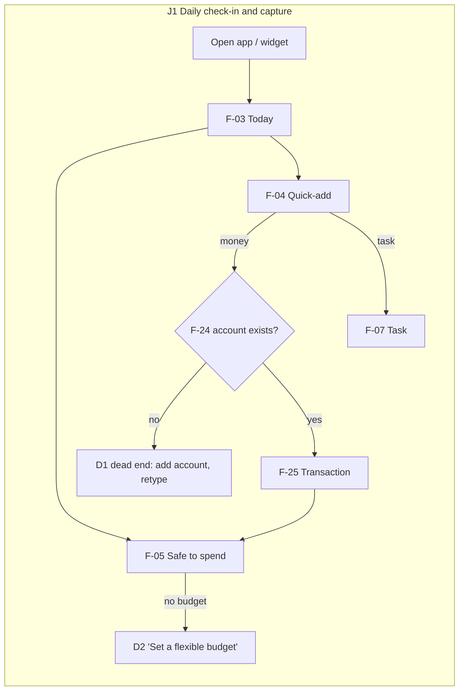
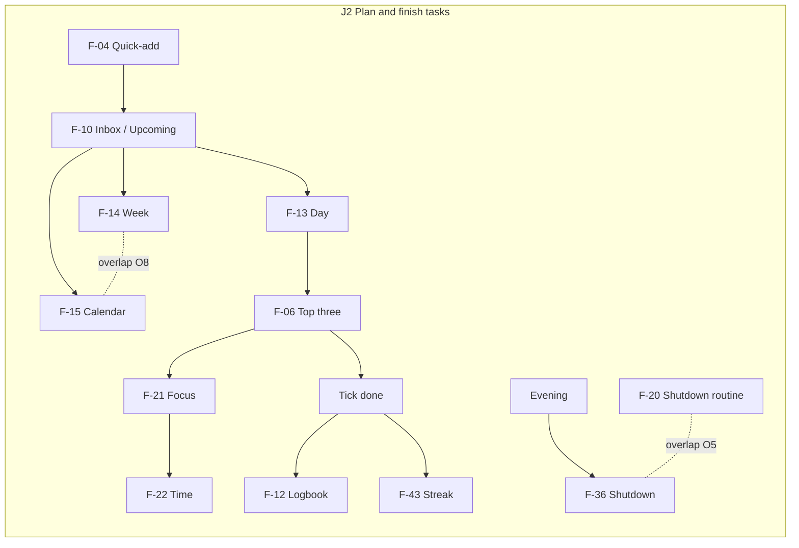
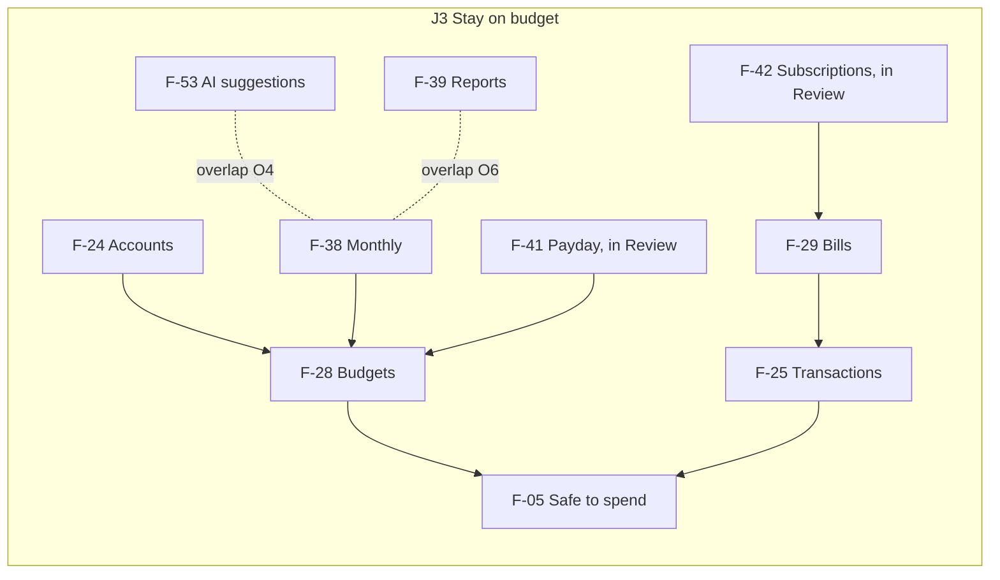

## Connection map

Link types: **Flow** (user moves A→B), **Data** (B reads what A writes), **Trigger** (A makes B run), **Shared** (same table/service/component), **Overlap** (same outcome, different way).

### Links

| From                            | To                                                         | Type                                                           | Evidence                                                                                    |
| ------------------------------- | ---------------------------------------------------------- | -------------------------------------------------------------- | ------------------------------------------------------------------------------------------- |
| F-04 Quick-add                  | F-25 Transactions, F-07 Tasks, F-22 Time                   | Flow / Data                                                    | `shared/quick-add*.ts` routes text to the right kind                                        |
| F-04 Quick-add                  | F-24 Accounts                                              | Data (blocking)                                                | No account ⇒ Save disabled (`mob/features/quick-add/quick-add-sheet.tsx:228`)               |
| F-04 Quick-add                  | F-27 Category rules                                        | Data                                                           | Clients `POST /category-rules`; rules pick the category                                     |
| F-25 Transactions               | F-05 Safe to spend, F-28 Budgets, F-43 Logging streak      | Data                                                           | `api/modules/budgets/service.ts`, `shared/gamification.ts`                                  |
| F-28 Budgets                    | F-05 Safe to spend                                         | Data (blocking)                                                | No flexible budget ⇒ card says "Set a flexible budget"                                      |
| F-29 Bills                      | F-25 Transactions                                          | Trigger                                                        | `POST /recurring/:id/pay` creates the transaction                                           |
| F-29 Bills                      | F-03 Today (money due), F-15 Plan calendar, F-56 Reminders | Data                                                           | `api/modules/today/service.ts`                                                              |
| F-30 Goals                      | F-07 Tasks                                                 | Trigger (on read)                                              | `GET /today` creates the monthly "move ৳X" task                                             |
| F-30/F-31/F-33/F-24             | F-25 Transactions                                          | Trigger                                                        | contribute, repay, checkout, balance check each write a transaction                         |
| F-41 Payday plan                | F-28 Budgets, F-30 Goals                                   | Data                                                           | writes budgets/jars                                                                         |
| F-38 Monthly review             | F-28 Budgets                                               | Data                                                           | next month's budgets                                                                        |
| F-53 AI budget suggestions      | F-28 Budgets                                               | Data / **Overlap** with F-38's rule-based suggestion           | `coach.ts:69` vs `reviews/service.ts:175`                                                   |
| F-42 Subscription spotter       | F-29 Bills                                                 | Trigger                                                        | "Track" creates a bill                                                                      |
| F-07 Tasks                      | F-06 Top three, F-10, F-13, F-14, F-15, F-12               | Shared (one `tasks` table)                                     |                                                                                             |
| F-08 Repeating                  | F-07                                                       | Trigger                                                        | completing creates the next copy                                                            |
| F-21 Focus                      | F-22 Time entries                                          | Data                                                           | focus sessions are time entries with source "focus"                                         |
| F-22 Time                       | F-23 Focus stats, F-39 Reports, F-40 Areas, F-37 Weekly    | Data / **Overlap** (hours shown in 5 places)                   |                                                                                             |
| F-18 Areas                      | F-07, F-22, F-25 (via categories), F-40, F-39              | Shared                                                         |                                                                                             |
| F-19 Habits                     | F-03, F-36, F-37, F-43                                     | Data / Flow                                                    |                                                                                             |
| F-36 Shutdown                   | F-06 (tomorrow's top three), F-19, F-25                    | Flow                                                           |                                                                                             |
| F-20 Routines (seeded Shutdown) | F-36 Shutdown                                              | **Overlap**                                                    | `api/db/seed.ts`                                                                            |
| F-37 Weekly                     | `settings.weeklyFocus`                                     | Data (write-only)                                              | `web/features/review/weekly-review.tsx:60`; nothing reads it except next week's placeholder |
| F-45 Tiki                       | almost every record feature                                | Shared (calls the app's own routes via `app.request`)          | `api/modules/ai/assistant/dispatch.ts`                                                      |
| F-45 Tiki                       | F-46, F-47, F-48, F-49                                     | Flow                                                           |                                                                                             |
| F-72 AI cap                     | F-04 (AI parse), F-26, F-45, F-50–F-53                     | Trigger (gate)                                                 | `api/modules/ai/usage.ts`                                                                   |
| F-55 AI switches                | F-45, F-04, F-26, F-50–F-53, F-76                          | Trigger (gate)                                                 |                                                                                             |
| F-60 Hide amounts               | every money view                                           | Shared — **not** F-57 widget, F-56 bill text                   |                                                                                             |
| F-03 Today                      | F-57 Widget                                                | Data                                                           | widget mirrors `/today`                                                                     |
| F-61 Offline queue              | every phone write                                          | Shared                                                         | `mob/lib/outbox*.ts`                                                                        |
| F-62 Export / F-63 Delete       | all tables, F-26 files, F-71 backups                       | Data                                                           | `api/db/user-files.ts`                                                                      |
| F-15 Plan calendar              | F-34 Spending calendar                                     | **Overlap** in shape and name only (future plan vs past spend) |                                                                                             |
| F-39 Reports                    | F-38 Monthly, F-40 Areas                                   | **Overlap** (net worth, hourly rate, by area)                  |                                                                                             |
| F-54 AI cost                    | F-70 Admin › AI cost                                       | **Overlap** (owner by-user view)                               |                                                                                             |
| F-66 `workdays`                 | F-66 `daysOff`                                             | **Overlap** (two settings, one concept)                        | `shared/schemas/settings.ts:37,46`                                                          |

### Hubs (many dependents; quality matters most)

1. **F-25 Transactions** — fed by F-04, F-24, F-29, F-30, F-31, F-33, F-42, F-45; feeds F-05, F-28, F-34, F-37–F-39, F-43. 13 links.
2. **F-07 Tasks** — feeds F-03, F-06, F-08, F-09, F-10–F-15, F-36, F-43. 12 links.
3. **F-03 Today** — reads F-05, F-06, F-19, F-22, F-29, F-30, F-43; feeds F-57. 9 links.
4. **F-45 Tiki** — touches 14 record kinds through the app's own routes.
5. **F-28 Budgets** — gates F-05 (the core number); written from 4 places.
6. **F-24 Accounts** — gates F-04 money entries and F-25.

### Islands (not on any core journey)

F-16 Eisenhower, F-17 Energy, F-20 Routines, F-32 Events, F-33 Shopping, F-34 Spending calendar, F-40 Areas dashboard, F-41 Payday plan, F-42 Subscriptions, F-54 AI cost (user), F-67 Cost in hours, and the dead F-73–F-77. F-41 and F-42 hold real value for J3 but sit in Review, away from the money screens they change.

### Overlaps

| #   | Same outcome              | Ways                                                                        | Evidence                                |
| --- | ------------------------- | --------------------------------------------------------------------------- | --------------------------------------- |
| O1  | See hours spent           | F-22 Time, F-23 Focus stats, F-39 Reports, F-40 Areas, F-37 Weekly          | web inventory §5                        |
| O2  | See area summary          | F-39 "By area", F-40 Areas dashboard, F-18 area page                        |                                         |
| O3  | Set budgets               | F-28 editor, F-38 Monthly, F-41 Payday                                      |                                         |
| O4  | Get budget suggestions    | F-38 rule-based, F-53 AI                                                    | `reviews/service.ts:175`, `coach.ts:69` |
| O5  | Run the evening wind-down | F-36 Daily shutdown, F-20 seeded Shutdown routine                           | `api/db/seed.ts`                        |
| O6  | Net worth / hourly rate   | F-38 Monthly, F-39 Reports                                                  |                                         |
| O7  | Month grid                | F-15 Plan calendar, F-34 Spending calendar                                  |                                         |
| O8  | Week of tasks             | F-14 Week planner, F-15 Calendar week mode                                  |                                         |
| O9  | AI cost per user (owner)  | F-54, F-70                                                                  |                                         |
| O10 | Manage areas              | Plan › Projects, area page, Review › Areas, Settings › Areas                | mobile inventory §6                     |
| O11 | Working days              | `workdays`, `daysOff`                                                       | `shared/schemas/settings.ts`            |
| O12 | Weekly summary (API)      | `/reviews/weekly`, `/insights/weekly-recap` (dead), `/ai/weekly-review`     |                                         |
| O13 | Log an expense (phone)    | 7 entry points, all the same `/add` sheet except the widget re-log and Tiki | Accepted: entry points, not features    |

### Dead ends

| #   | Where                           | What happens                                                                                             |
| --- | ------------------------------- | -------------------------------------------------------------------------------------------------------- |
| D1  | F-04 with no account (new user) | Save disabled; "Add your first account" replaces the sheet; the typed text is lost; ~6 taps and retyping |
| D2  | F-05 with no budgets (new user) | Card says "Set a flexible budget"; the core number is missing on day one                                 |
| D3  | F-37 Finish                     | Toast, back to `/review`; the week's focus never shows again during the week                             |
| D4  | F-41 Save                       | Goes to `/review`, not to the budgets just written                                                       |
| D5  | F-42 Track                      | Toast, no link to the new bill                                                                           |
| D6  | F-15 bill rows (web)            | Not clickable                                                                                            |
| D7  | F-55 Auto-categorise            | Switch with no effect                                                                                    |
| D8  | Bad URL (web)                   | No 404 page (no `notFound` component)                                                                    |
| D9  | Phone first run                 | No setup or tour; notification permission prompt with no context after 1.5 s                             |

### Detours

| #   | Journey step              | Detour                                                                               |
| --- | ------------------------- | ------------------------------------------------------------------------------------ |
| T1  | Phone: change any setting | Review tab → scroll to the bottom → Settings (Settings isn't on Today or a tab)      |
| T2  | J3 monthly check          | Review → Monthly for budgets vs actual, though Money › Budgets is where budgets live |
| T3  | J3 payday                 | Review → Payday plan, though salary arrives as a Bills "Received" tap                |
| T4  | J3 subscriptions          | Review → Subscriptions, though the result is a bill                                  |

### Journey diagrams

## Core journeys — current step counts

Counted from the inventories (web clicks / phone taps from Today). "Step" = one click, tap or Enter; typing counts as one step.

### J1 Daily check-in and capture (expense)

| #         | Returning user, phone                                       | New user, phone                                                                 |
| --------- | ----------------------------------------------------------- | ------------------------------------------------------------------------------- |
| 1         | Open app (Today shows safe to spend)                        | Open app: Today with "Set a flexible budget", empty sections, permission prompt |
| 2         | Tap +                                                       | Tap +                                                                           |
| 3         | Type "lunch 250"                                            | Type "lunch 250"                                                                |
| 4         | Save (pickers for Kind/Account/Category visible, untouched) | Save disabled → tap "Add your first account"                                    |
| 5         |                                                             | Fill account name and type                                                      |
| 6         |                                                             | Save account                                                                    |
| 7         |                                                             | Tap + again                                                                     |
| 8         |                                                             | Retype "lunch 250"                                                              |
| 9         |                                                             | Save                                                                            |
| **Steps** | **4**                                                       | **9**, and safe to spend still empty                                            |

Web returning user: N, type, Enter = **3**.

### J2 Plan and finish a task

| #         | Step                                                                                                            |
| --------- | --------------------------------------------------------------------------------------------------------------- |
| 1         | + / N                                                                                                           |
| 2         | Type "call bank tomorrow"                                                                                       |
| 3         | Save                                                                                                            |
| 4         | Next day: tick on Today                                                                                         |
| **Steps** | **4** (web the same; the web task panel can't complete a task, so finishing from the panel adds Esc + find row) |

### J3 Stay on budget (monthly check and adjust, phone)

| #         | Step                                                                                                                        |
| --------- | --------------------------------------------------------------------------------------------------------------------------- |
| 1         | Review tab                                                                                                                  |
| 2         | Monthly review                                                                                                              |
| 3         | Scroll to budgets vs actual                                                                                                 |
| 4         | Pick suggestion type (rule-based or "Ask AI")                                                                               |
| 5         | Edit next month's budgets                                                                                                   |
| 6         | Save                                                                                                                        |
| **Steps** | **6**, in the Review tab, away from Money › Budgets. First-time setup (accounts + budgets) adds about 8 more with no guide. |

### J4 Weekly review (secondary)

Review → Weekly → Next ×4 → Finish = **7**; the focus set at the end is never shown again.
