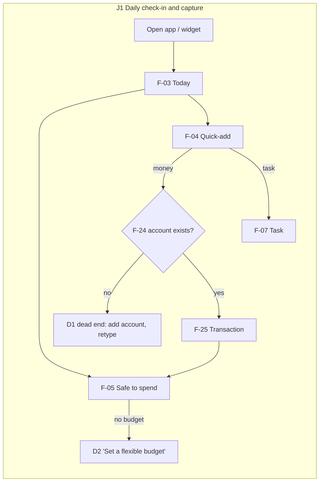
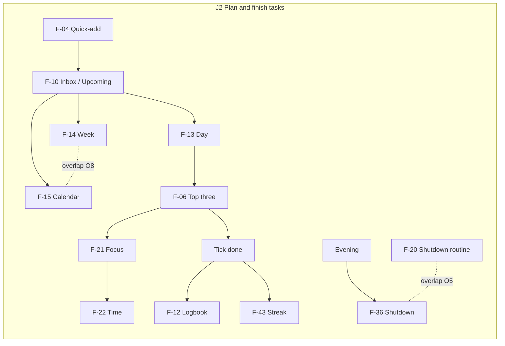
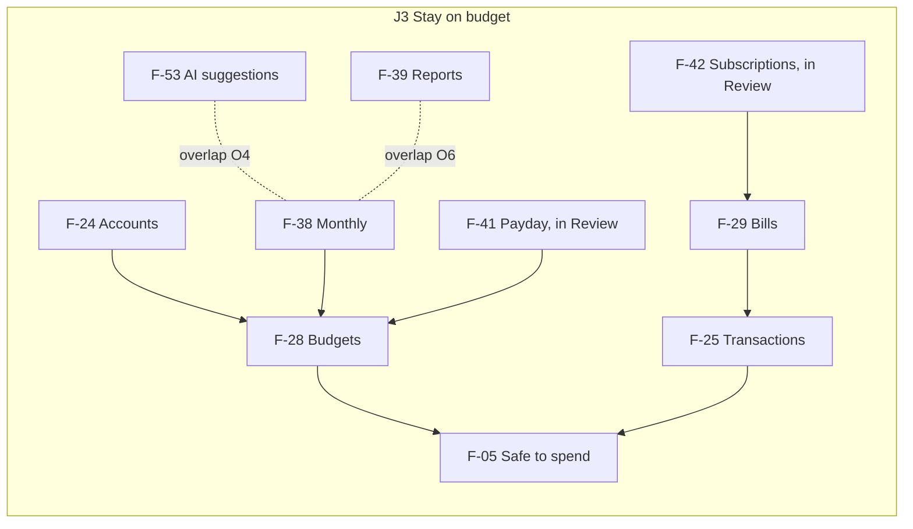

# Product Audit: Tick & Taka

31 October 2026 · Scope: Android app (`apps/mobile`), web app (`apps/web`), API and jobs (`apps/api`), shared logic (`packages/shared`), public site, owner admin; product docs (`PRODUCT.md`, `DESIGN.md`, `docs/*`) and the four earlier audits (`docs/audit/2026-10-0*`) · Not reviewed: the app running on a real phone (Tiki v2 phone screens untested on device), real usage (production has one account and no records; no analytics in either app), visual design and accessibility (covered by the earlier audits), code quality beyond what affects users.

Working files: `01-context.md`, `02-inventory.md`, `03-connections.md`, `04-assessment.md`, `05-additions.md`. This is a read-only audit; no application code was changed.

## 1. Summary

- **Core job:** know what to do next and what you can safely spend today, and capture a task or a taka in a few seconds (`PRODUCT.md:13`).
- **Features found:** 77 (complete 61 · partial 11 · stub/dead 5 · broken 0 found).
- **Proposed:** remove 5 · merge 7 (6 features absorbed, 1 settings merge) · simplify 8 · hide 4 · automate 1 · fix 7 · add 5 (1 new state, 4 extensions of existing features) → **67 features**.
- **Navigation:** web sidebar 29 → 23 destinations; phone Review list 10 → 5; web Settings 54 → 48 controls; API endpoints with no caller 4 → 0.
- **Core journey steps:**
  - J1, a new phone user logging their first expense: 9 → 4.
  - J1, a returning user: 4 → 4, with three fewer pickers on screen.
  - J2, task to done: 4 → 4 (finishing from the web panel: 3 → 1).
  - J3, the monthly budget check: 6 → 4.
  - J3, first-time budget setup: about 8 → 2.
- **Top 3 recommendations:**
  1. **R-01 + R-02: make day one work.** Seed a Cash account and ask for one "spending money this month" number on the safe-to-spend card. Today a new user's first expense is blocked and the app's core number is blank.
  2. **R-09, R-10, R-12, R-13, R-18: put features where their result lives.** Payday plan moves into Budgets, Subscriptions into Bills, Focus statistics into Time and the Spending calendar into Transactions, and AI cost goes behind Settings. Review drops from 9 items to 5.
  3. **R-03 + R-05: cut what lies or clutters.** Delete the four dead endpoints, the dead SMS table and the "Auto-categorise" switch that does nothing. Show quick-add's pickers only when the parser is unsure; this has been open since audit round 4 and goes against principle 2.

The app is not bloated at its core: capture is 1–4 steps and Today answers both questions with zero taps. The weight sits in the Review tab, in repeated views of the same numbers (hours in 5 places, budgets set in 3, area summaries in 3), and in a first run built for a single owner who already had accounts and budgets.

## 2. Context and assumptions

| Field                  | Value                                                                                                                                                                                                                                                                                                                                                                                                                                                                                                             |
| ---------------------- | ----------------------------------------------------------------------------------------------------------------------------------------------------------------------------------------------------------------------------------------------------------------------------------------------------------------------------------------------------------------------------------------------------------------------------------------------------------------------------------------------------------------- |
| App name               | Tick & Taka [Verified] `README.md:1`                                                                                                                                                                                                                                                                                                                                                                                                                                                                              |
| What it does           | One place for your day and your money: what to do next, how much is safe to spend today, and fast logging of tasks, expenses and hours. [Verified] `README.md:3-5`                                                                                                                                                                                                                                                                                                                                                |
| Primary users          | `PRODUCT.md:9` [Verified]: "One person (the owner) juggling two remote jobs, teaching, research and home… many times a day in short bursts… Never shared, never onboarded." The code has since grown open Google sign-up, per-user databases, invite-only, admin and a web tour [Verified] — so the real audience is now **the owner first, plus a small number of invited people like them** (Bangla/English, Taka, Dhaka) **[Assumption — confirm]**.                                                           |
| Secondary roles        | Owner / super admin (`OWNER_EMAIL`): users, AI cost, health, access control. [Verified] `apps/api/src/modules/admin/`                                                                                                                                                                                                                                                                                                                                                                                             |
| Core job               | "Open it and see what to do next and how much is safe to spend today, then log a task, an expense or an hour of work in a few seconds." [Verified] `README.md:3-5`                                                                                                                                                                                                                                                                                                                                                |
| Business goal / metric | `PRODUCT.md:13` [Verified]: "Success is still opening it every day after three months, because logging feels quick and rewarding." Capture target: "log a task, expense, income or time entry in under five seconds." Spec rule: "Every feature earns its place. A feature I don't touch for a month gets hidden or removed." (`docs/audit/2026-10-07-r4/_raw/spec.txt:39`). No revenue goal [Inferred].                                                                                                          |
| Platforms              | Android app (Expo, offline-first, home-screen widget), web app at `/app/` (desktop-first, online only), Hono API, public site pages (`/`, `/privacy`, `/terms`), owner admin panel (web only). [Verified]                                                                                                                                                                                                                                                                                                         |
| Hard constraints       | Google OAuth verification needs public home, privacy and terms pages [Verified] `docs/google-oauth-verification.md`; account deletion and full JSON export [Verified] `README.md` "Privacy and accounts"; per-user databases (privacy model) [Verified]; AI spend cap per user [Verified].                                                                                                                                                                                                                        |
| Known pain points      | Four earlier audits (`docs/audit/2026-10-0*`, Android only, before the web app). Still open: quick-add shows Kind/Account/Category pickers on every money entry, against principle 2 (`apps/mobile/src/features/quick-add/quick-add-sheet.tsx:160-191`); Settings only reachable through the Review tab on the phone; reminders only rescheduled when the app opens (QA-022). None of the audits looked at feature count, overlap or navigation breadth. The web app, admin, tour and Tiki v2 were never audited. |
| Principles             | `PRODUCT.md:29-33`: Today first, one glance · Capture beats organise · Big, calm, thumb-sized · Colour means something · Reward, never guilt. Anti-reference: "Feature-overloaded planners where every screen shows every option (TickTick's main complaint)" (`PRODUCT.md:21`).                                                                                                                                                                                                                                  |
| Usage data             | **None usable.** Production (checked read-only, 31 Oct 2026) has 1 account (the owner), 0 tasks, 0 transactions, 2 seeded routines and 1 Tiki chat. No analytics SDK in either app [Inferred: none found]. All Reach scores in this audit are **estimates**.                                                                                                                                                                                                                                                      |

### Core job (one sentence)

Know what to do next and what you can safely spend today, and capture a task or a taka in a few seconds.

### Core journeys

- **J1 — Daily check-in and capture.** Open the app, read Today (next up, safe to spend, top three), log an expense or a task from quick-add, close.
- **J2 — Plan and finish tasks.** Capture to Inbox, give it a day (Today / tomorrow / week), work it (optionally with a focus timer), tick it done.
- **J3 — Stay on budget.** Set up accounts and budgets once, then each day trust "safe to spend"; once a month check where money went and adjust.

Secondary journey (habit-forming, not core): **J4 — Review**: daily shutdown / weekly review.

Assumptions the conclusions depend on:

- **[Assumption A1]** The audience is now the owner plus invited people like them (Q1). If it is the owner alone, R-01, R-02 and R-24 drop in priority, but R-03 to R-22 stand.
- **[Assumption A2]** Reach scores are estimates from placement and defaults; no usage data exists.
- **[Assumption A3]** "Core" means the three journeys in §2; the Review rituals are secondary.

## 3. Feature inventory

Platforms: **W** web (`apps/web`), **M** Android (`apps/mobile`), **A** API only, **P** public site. Paths are shortened: `web/` = `apps/web/src/`, `mob/` = `apps/mobile/src/`, `api/` = `apps/api/src/`, `shared/` = `packages/shared/src/`. Status and notes are **[Verified]** from code unless tagged.

### Capture and Today

| ID   | Name                        | Description                                                                                                | Role   | Platf. | Entry points                                                           | Evidence                                                                                               | Status   | Notes                                                                                                                                                                                                                                                              |
| ---- | --------------------------- | ---------------------------------------------------------------------------------------------------------- | ------ | ------ | ---------------------------------------------------------------------- | ------------------------------------------------------------------------------------------------------ | -------- | ------------------------------------------------------------------------------------------------------------------------------------------------------------------------------------------------------------------------------------------------------------------ |
| F-01 | Google sign-in and sessions | Sign in with Google; 30-day sliding sessions; sign out                                                     | user   | W M    | `/login`, app start                                                    | `api/modules/auth/routes.ts`, `api/db/sessions.ts`, `web/routes/login.tsx`, `mob/app/login.tsx`        | Complete | Invite-only and blocked accounts handled. Name reads "TickNTaka" on login and site, "Tick & Taka" elsewhere (`api/modules/site/layout.ts:4`)                                                                                                                       |
| F-02 | Public home, privacy, terms | Pages Google's consent screen points at                                                                    | public | P      | `/`, `/privacy`, `/terms`                                              | `api/modules/site/*`                                                                                   | Complete | Required for OAuth verification (`docs/google-oauth-verification.md`)                                                                                                                                                                                              |
| F-03 | Today                       | Next up, safe to spend, top three, day-fit bar, habits, money due, Later list, 4 quick actions, Tiki mood  | user   | W M    | Home, `G T`                                                            | `web/features/today/*`, `mob/app/(tabs)/index.tsx`, `api/modules/today/service.ts`                     | Complete | `GET /today` also creates monthly goal tasks as a side effect (`goals`). Weekly-recap row hard-coded to Friday (`web/features/today/later-today.tsx:25`, `mob/features/today/later-today.tsx:32`)                                                                  |
| F-04 | Quick-add                   | One field parses "cha 20", "+45000 salary", "2h thesis", "call bank tomorrow 5pm"; AI fallback when unsure | user   | W M    | Top bar `N`, `/`, phone `+`, Today/Money buttons, widget, app shortcut | `shared/quick-add*.ts`, `web/features/quick-add/*`, `mob/features/quick-add/quick-add-sheet.tsx`       | Partial  | Kind/Account/Category pickers shown on every money entry, against principle 2 (`quick-add-sheet.tsx:160-191`, open since audit r4). With no account, Save is disabled and "Add your first account" replaces the sheet; typed text lost (`quick-add-sheet.tsx:228`) |
| F-05 | Safe to spend today         | Flexible budget left today plus pace alert                                                                 | user   | W M    | Today card, widget                                                     | `api/modules/budgets/service.ts:224`, `shared/finance.ts`, `mob/features/today/safe-to-spend-card.tsx` | Complete | Shows "Set a flexible budget" until a budget exists; new users have none                                                                                                                                                                                           |
| F-06 | Top three                   | Pick three tasks for today; confetti when all done                                                         | user   | W M    | Today, palette, `T` key, task panel toggle, Shutdown step              | `web/features/tasks/pick-top-three-panel.tsx`, `mob/features/tasks/pick-top-three-sheet.tsx`           | Complete |                                                                                                                                                                                                                                                                    |
| F-07 | Task editing                | When, estimate, deadline, priority, area/project, subtasks, reminder                                       | user   | W M    | Any task row; `?panel=task:id`; `task/[id]` sheet                      | `web/features/tasks/task-panel.tsx`, `mob/features/tasks/*`, `api/modules/tasks/service.ts`            | Partial  | Web panel's primary button says "Done" but means Save, and the panel has no "complete" control (`task-panel.tsx:170`). Mobile `/task/new` mode has no caller                                                                                                       |
| F-08 | Repeating tasks             | "every other Tuesday"; finishing one makes the next                                                        | user   | W M A  | Task editor, quick-add text                                            | `api/modules/tasks/service.ts:80,251`, `shared/recurrence.ts`                                          | Complete |                                                                                                                                                                                                                                                                    |
| F-09 | Rescue the day              | Move all overdue to today/tomorrow/inbox; move low priority when the day doesn't fit                       | user   | W M    | Today Later list                                                       | `api/modules/tasks/bulk-move.ts`, `web/features/today/bulk-move.ts`                                    | Complete | With Undo                                                                                                                                                                                                                                                          |

### Plan and time

| ID   | Name               | Description                                                      | Role | Platf. | Entry points                                     | Evidence                                                                                             | Status   | Notes                                                                                                                                                                                        |
| ---- | ------------------ | ---------------------------------------------------------------- | ---- | ------ | ------------------------------------------------ | ---------------------------------------------------------------------------------------------------- | -------- | -------------------------------------------------------------------------------------------------------------------------------------------------------------------------------------------- |
| F-10 | Inbox and upcoming | Undated tasks, next 14 days                                      | user | W M    | Plan home                                        | `web/features/plan/plan-home.tsx`, `mob/features/plan/plan-home.tsx`                                 | Complete |                                                                                                                                                                                              |
| F-11 | Someday            | Parked ideas                                                     | user | W M    | Plan nav/More                                    | `someday-list.tsx`                                                                                   | Complete |                                                                                                                                                                                              |
| F-12 | Logbook            | Finished tasks                                                   | user | W M    | Plan nav/More                                    | `logbook-list.tsx`                                                                                   | Complete |                                                                                                                                                                                              |
| F-13 | Day timeline       | Drag tasks onto hours                                            | user | W M    | Plan › Day, Today "Full day"                     | `web/features/plan/day-timeline.tsx`                                                                 | Complete |                                                                                                                                                                                              |
| F-14 | Week planner       | Drag tasks onto days                                             | user | W M    | Plan › Week                                      | `week-planner.tsx`                                                                                   | Complete |                                                                                                                                                                                              |
| F-15 | Plan calendar      | Month/week grid of tasks plus scheduled bills and paydays        | user | W M    | Plan › Calendar                                  | `web/features/plan/calendar-view.tsx`, `calendar-day.tsx`                                            | Partial  | Web bill rows have no click handler [Verified by inventory read]. Week mode overlaps F-14                                                                                                    |
| F-16 | Eisenhower grid    | Urgent/important quadrants                                       | user | W M    | Plan (flag `advancedViews.eisenhower`, off)      | `eisenhower-grid.tsx`                                                                                | Complete | Also gates the "Urgent" field                                                                                                                                                                |
| F-17 | Energy tags        | Tag tasks by energy                                              | user | W M    | Task editor (flag `advancedViews.energy`, off)   | `shared/schemas/settings.ts`                                                                         | Complete |                                                                                                                                                                                              |
| F-18 | Areas and projects | Life areas, projects inside them                                 | user | W M    | Sidebar Areas, Plan › Projects, Settings › Areas | `web/features/plan/area-detail.tsx`, `project-view.tsx`, `api/modules/areas`, `api/modules/projects` | Complete | Managed in 4 places (Plan, area page, Review › Areas, Settings › Areas). Seeded areas are the owner's own: "Job 1, Job 2, Teaching, Research, Home, Personal" (`shared/defaults.ts:245-258`) |
| F-19 | Habits             | Daily/weekly targets, streaks, freeze days, reminder             | user | W M    | Today chips, Plan › Habits, Shutdown, Weekly     | `web/features/habits/*`, `api/modules/habits/service.ts`                                             | Complete |                                                                                                                                                                                              |
| F-20 | Routines           | Ordered checklists with step timers; seeded Morning and Shutdown | user | W M    | Plan › Routines                                  | `web/features/routines/*`, `api/modules/routines/service.ts`, `api/db/seed.ts`                       | Complete | Seeded "Shutdown" routine repeats the built-in Daily shutdown (F-36); Morning's "Pick top three" repeats F-06                                                                                |
| F-21 | Focus timer        | Pomodoro linked to a task; a plant grows; bell at the end        | user | W M    | Today "Focus", palette, widget, subtasks         | `web/features/focus/*`, `mob/features/focus/*`                                                       | Complete |                                                                                                                                                                                              |
| F-22 | Time tracking      | Start/stop timer, manual entries, billable, week by area         | user | W M    | Plan › Time, top-bar pill, palette "Log time"    | `web/features/time/time-tracking.tsx`, `api/modules/time-entries/*`                                  | Complete |                                                                                                                                                                                              |
| F-23 | Focus statistics   | Focus minutes by day and area                                    | user | W M    | Plan › Focus statistics                          | `web/features/time/focus-stats.tsx`, `GET /time-entries/focus-stats`                                 | Complete | Subset of F-22's data                                                                                                                                                                        |

### Money

| ID   | Name                       | Description                                                                              | Role | Platf. | Entry points                                  | Evidence                                                                                                   | Status   | Notes                                                                                                                                                                                                         |
| ---- | -------------------------- | ---------------------------------------------------------------------------------------- | ---- | ------ | --------------------------------------------- | ---------------------------------------------------------------------------------------------------------- | -------- | ------------------------------------------------------------------------------------------------------------------------------------------------------------------------------------------------------------- |
| F-24 | Accounts and balance check | Cash, bank, wallet, card, savings; "Fix it" logs an adjustment                           | user | W M    | Money › Accounts, overview                    | `api/modules/accounts/service.ts:52`, `accounts-view.tsx`                                                  | Complete | No account seeded for new users                                                                                                                                                                               |
| F-25 | Transactions               | Expense, income, transfer (fee, foreign currency), search, links to goal/debt/event/bill | user | W M    | Money › Transactions, `G X`                   | `api/modules/transactions/service.ts`, `transactions-view.tsx`, `mob/features/money/transaction-sheet.tsx` | Complete |                                                                                                                                                                                                               |
| F-26 | Receipt photo and AI read  | Camera/library or drop/paste; AI fills amount, category, note                            | user | W M    | Transaction sheet, quick-add drop             | `mob/lib/receipts.ts`, `api/modules/uploads/routes.ts`, `POST /ai/receipt`                                 | Partial  | Photo stays on the server when its transaction is deleted; only account deletion removes files (`api/db/user-files.ts`). Camera permission is in the built APK (aapt check), contrary to an initial suspicion |
| F-27 | Categories and rules       | Two-level categories; changing a category on a noted transaction teaches a rule          | user | W M    | Settings › Areas and categories               | `api/modules/categories`, `api/modules/category-rules/service.ts`                                          | Complete | Learning is automatic already                                                                                                                                                                                 |
| F-28 | Budgets                    | Flexible / fixed / non-monthly buckets, rollover, pace, editor                           | user | W M    | Money › Budgets, Today card                   | `api/modules/budgets/service.ts`, `budgets-view.tsx`, `budget-editor.tsx`, `mob/app/budget-edit.tsx`       | Complete | Budgets can be set in 3 places (editor, Monthly, Payday)                                                                                                                                                      |
| F-29 | Bills and income           | Scheduled bills and paydays; Paid/Received logs the transaction; nightly overdue         | user | W M    | Money › Bills, Today money due, notifications | `api/modules/recurring/service.ts`                                                                         | Complete |                                                                                                                                                                                                               |
| F-30 | Savings goals              | Jars, contributions, monthly "move ৳X" task                                              | user | W M    | Money › Goals                                 | `api/modules/goals/service.ts`                                                                             | Complete | Monthly task created by a read of `GET /today`                                                                                                                                                                |
| F-31 | Debts                      | Lent / borrowed, partial repayment, payoff forecast                                      | user | W M    | Money › Debts                                 | `api/modules/debts/service.ts`                                                                             | Complete |                                                                                                                                                                                                               |
| F-32 | Events                     | Trip or occasion budgets that collect tagged spending                                    | user | W M    | Money › Events (More)                         | `api/modules/events/routes.ts`                                                                             | Complete | Mobile can't start a new event from a route (`event/[id]` edit only); created inline                                                                                                                          |
| F-33 | Shopping list              | Priced list; checkout becomes one expense                                                | user | W M    | Money › Shopping (flag, off)                  | `api/modules/shopping/routes.ts`                                                                           | Complete |                                                                                                                                                                                                               |
| F-34 | Spending calendar          | Month grid of actual daily spending; pick a day to see its transactions                  | user | W M    | Money › Calendar                              | `money-calendar.tsx`                                                                                       | Complete | Same month-grid shape as F-15, different job; Reports also has spending by day                                                                                                                                |
| F-35 | Money overview             | Total balance, Expense/Income, accounts, month's budgets, recent                         | user | W M    | Money tab, `G M`                              | `money-overview*.tsx`, `mob/features/money/money-home.tsx`                                                 | Complete | Hub                                                                                                                                                                                                           |

### Review

| ID   | Name                    | Description                                                                                      | Role | Platf. | Entry points                                                            | Evidence                                                                  | Status   | Notes                                                                                                                                                                                                                                                 |
| ---- | ----------------------- | ------------------------------------------------------------------------------------------------ | ---- | ------ | ----------------------------------------------------------------------- | ------------------------------------------------------------------------- | -------- | ----------------------------------------------------------------------------------------------------------------------------------------------------------------------------------------------------------------------------------------------------- |
| F-36 | Daily shutdown          | Done, carry over, habits, tomorrow's top three, missed spending (web 5 steps, phone 3)           | user | W M    | Review, `G S`, 21:30 reminder                                           | `web/features/review/shutdown-flow.tsx`, `api/modules/reviews/service.ts` | Complete |                                                                                                                                                                                                                                                       |
| F-37 | Weekly review           | Hours, spending, habits, wins, next week's focus, optional AI coach                              | user | W M    | Review, Today row (Fri), Review row (Sun), reminder (`weeklyReviewDay`) | `web/features/review/weekly-review.tsx`, `GET /reviews/weekly`            | Partial  | Prompted on three different days (Fri hard-coded on Today, Sun hard-coded on Review home `review-home.tsx:91`/`:78`, setting for the reminder). Saved `weeklyFocus` is written (`weekly-review.tsx:60`) and only reappears as next week's placeholder |
| F-38 | Monthly review          | Budgets vs actual, Someday, net worth, hourly rate, next month's budgets (rule-based suggestion) | user | W M    | Review › Monthly                                                        | `monthly-review.tsx`, `api/modules/reviews/service.ts:175`                | Complete | Net worth and hourly rate repeat F-39                                                                                                                                                                                                                 |
| F-39 | Reports                 | Spending by category and day, income vs spending, net worth, hours by area, by area              | user | W M    | Review › Reports (`review/insights` on phone)                           | `insights-screen.tsx`, `api/modules/insights/summary.ts`                  | Complete |                                                                                                                                                                                                                                                       |
| F-40 | Areas dashboard         | Per area: hours this week, money this month, open tasks                                          | user | W M    | Review › Areas                                                          | `area-dashboard.tsx`, `GET /insights/areas`                               | Complete | Repeats Reports "By area" and links to the Plan area page                                                                                                                                                                                             |
| F-41 | Payday plan             | Split a salary across budgets and jars down to ৳0                                                | user | W M    | Review › Payday                                                         | `payday-plan.tsx`                                                         | Complete | Writes budgets, then returns to `/review`, not Budgets                                                                                                                                                                                                |
| F-42 | Subscription spotter    | Finds repeating charges; "Track" makes a bill                                                    | user | W M    | Review › Subscriptions, Monthly                                         | `subscriptions-screen.tsx`, `api/modules/insights/spotter.ts`             | Complete | Track gives a toast with no link to Bills                                                                                                                                                                                                             |
| F-43 | Streaks and Tiki's mood | Daily task goal, logging-same-day streak, freezes, vacation                                      | user | W M    | Today header, Review home                                               | `api/modules/gamification/service.ts`, `shared/gamification.ts`           | Complete | Directly serves the success metric                                                                                                                                                                                                                    |
| F-44 | Celebrations            | Sounds, haptics (phone), confetti for top three, routine, goal                                   | user | W M    | Automatic                                                               | `mob/lib/sounds.ts`, `mob/lib/haptics.ts`                                 | Complete |                                                                                                                                                                                                                                                       |

### Tiki and AI (all hidden when the server has no OpenAI key)

| ID   | Name                     | Description                                                                                                   | Role        | Platf. | Entry points                                                                   | Evidence                                                                                                | Status   | Notes                                                                                  |
| ---- | ------------------------ | ------------------------------------------------------------------------------------------------------------- | ----------- | ------ | ------------------------------------------------------------------------------ | ------------------------------------------------------------------------------------------------------- | -------- | -------------------------------------------------------------------------------------- |
| F-45 | Tiki chat                | Chat that finds, adds, changes, deletes (with Undo), money as drafts, record cards, screen-aware, saved chats | user        | W M    | Floating button, `Ctrl J`, palette, Review row, "Ask Tiki" in task/transaction | `api/modules/ai/assistant/*`, `web/features/assistant/*`, `mob/features/assistant/*`, `docs/TIKI_V2.md` | Complete | New screens on phone not yet device-tested (31 Oct)                                    |
| F-46 | What Tiki remembers      | "remember…" notes used in every chat; list in Settings                                                        | user        | W M    | Chat, Settings › Tiki and AI                                                   | `api/modules/ai/assistant/notes.ts`                                                                     | Complete |                                                                                        |
| F-47 | Briefing and suggestions | Opening lines and prompt chips fitted to screen and hour                                                      | user        | W M    | Empty chat                                                                     | `shared/tiki-briefing.ts`, `shared/tiki-suggestions.ts`                                                 | Complete | No AI cost                                                                             |
| F-48 | Reply feedback           | Thumbs up/down, optional comment; owner sees totals                                                           | user, owner | W M    | Under each reply                                                               | `POST /ai/feedback`, `api/db/feedback-store.ts`                                                         | Complete | Only user-feedback signal in the product                                               |
| F-49 | Voice input              | Talk in Bangla or English; server transcribes                                                                 | user        | W M    | Chat mic, widget 🎙                                                             | `api/modules/ai/voice.ts`, `mob/features/assistant/use-voice-input.ts`                                  | Complete |                                                                                        |
| F-50 | Plan my day (AI)         | Proposes a timeline for today                                                                                 | user        | W M    | Day timeline                                                                   | `api/modules/ai/planning.ts:26`                                                                         | Complete |                                                                                        |
| F-51 | Break it down (AI)       | Subtasks for a big task                                                                                       | user        | W M    | Task editor                                                                    | `planning.ts:110`                                                                                       | Complete |                                                                                        |
| F-52 | Weekly coach (AI)        | Explains the weekly numbers                                                                                   | user        | W M    | Weekly review                                                                  | `api/modules/ai/coach.ts:25`                                                                            | Complete |                                                                                        |
| F-53 | AI budget suggestions    | Suggests next month's budgets                                                                                 | user        | W M    | Monthly review, Budgets                                                        | `coach.ts:69`                                                                                           | Complete | Second way to get the same thing as F-38's rule-based suggestion                       |
| F-54 | AI cost screen           | My AI spend by day and feature; owner sees by user                                                            | user, owner | W M    | Review › AI usage, Settings › AI row                                           | `ai-usage-screen.tsx`, `api/modules/ai/usage-report.ts`                                                 | Complete | Web sidebar shows it even when AI is off; owner's by-user view repeats Admin › AI cost |
| F-55 | AI switches              | Master switch plus 8 per-feature switches                                                                     | user        | W M    | Settings › Tiki and AI                                                         | `web/features/settings/ai-section.tsx`, `mob/features/settings/ai-settings.tsx`                         | Partial  | The "Auto-categorise" switch controls nothing (F-76)                                   |

### Phone-only, privacy, settings, platform

| ID   | Name                          | Description                                                                                                                                  | Role          | Platf. | Entry points                                  | Evidence                                                                                                  | Status   | Notes                                                                                                                                                                               |
| ---- | ----------------------------- | -------------------------------------------------------------------------------------------------------------------------------------------- | ------------- | ------ | --------------------------------------------- | --------------------------------------------------------------------------------------------------------- | -------- | ----------------------------------------------------------------------------------------------------------------------------------------------------------------------------------- |
| F-56 | Reminders                     | Phone: task, bill (early and due), habit, debt, shutdown, weekly, budget pace, focus end. Web: browser reminders for focus, shutdown, weekly | user          | W M    | Automatic; Settings › Reminders/Notifications | `mob/features/notifications/*`, `mob/lib/notifications.ts`, `web/features/settings/browser-reminders.tsx` | Partial  | Phone schedules only 7 days ahead and only when the app opens (QA-022, open). Permission asked 1.5 s after first load with no context. No per-type switches on the phone; web has 3 |
| F-57 | Home-screen widget            | Safe to spend, next up, progress, add buttons, one-tap re-log of frequent spends                                                             | user          | M      | Launcher                                      | `mob/features/widget/*`                                                                                   | Partial  | Shows amounts even with Hide amounts on                                                                                                                                             |
| F-58 | App shortcuts                 | Long-press icon: expense, focus, quick add                                                                                                   | user          | M      | Launcher                                      | `mob/features/app/use-app-shortcuts.ts`                                                                   | Complete |                                                                                                                                                                                     |
| F-59 | App lock                      | Fingerprint/face on start and after 5 min away                                                                                               | user          | M      | Settings › Privacy                            | `mob/features/security/*`                                                                                 | Complete | `lockAfterMinutes` not editable (fine)                                                                                                                                              |
| F-60 | Hide amounts                  | One switch masks money everywhere                                                                                                            | user          | W M    | Eye icon (Today, Money), `⇧H`, Settings       | `mob/lib/privacy.ts`, `web/lib/*`                                                                         | Partial  | Widget and bill notifications still show amounts                                                                                                                                    |
| F-61 | Offline queue                 | Changes queue on the phone, replay in order, stuck-write banner                                                                              | user          | M      | Automatic                                     | `mob/lib/outbox*.ts`, `GET /sync/changes`                                                                 | Complete | Web is online only by decision                                                                                                                                                      |
| F-62 | Export all data               | One JSON file of everything                                                                                                                  | user          | W M    | Settings › Account / Your data                | `GET /export`, `api/modules/sync/routes.ts:83`                                                            | Complete | **Required** (privacy page promise). Still exports dead `sms_imports`                                                                                                               |
| F-63 | Delete account                | Export, confirm, type to delete; removes DB, files, backups, sessions                                                                        | user          | W M    | Settings › Account                            | `DELETE /auth/account`, `api/db/user-files.ts`                                                            | Complete | **Required**                                                                                                                                                                        |
| F-64 | Settings                      | Web 7 sections, 54 controls; phone 9 screens, 34 settings                                                                                    | user          | W M    | Web sidebar, `G ,`; phone: Review tab only    | `web/features/settings/*`, `mob/features/settings/*`                                                      | Partial  | Phone Settings reachable only from the bottom of Review. Phone lacks weekly review day/time and workdays; web lacks fingerprint lock (by platform)                                  |
| F-65 | Appearance                    | Theme, accent tint, Tiki's outfit, Bangla digits                                                                                             | user          | W M    | Settings › General/Appearance, top bar theme  | `web/lib/theme.ts`, `shared/schemas/settings.ts`                                                          | Complete |                                                                                                                                                                                     |
| F-66 | Workdays, days off, vacation  | Which days count for "every weekday", day-fit, streaks                                                                                       | user          | W M    | Settings › Your day                           | `shared/schemas/settings.ts:37,46`, `shared/recurrence.ts:52`                                             | Partial  | Two settings for one idea: `workdays` default Sun–Thu, `daysOff` default Fri, so Saturday is neither (inconsistent by default). Phone can't edit `workdays`                         |
| F-67 | Cost in hours                 | Show a big price as hours of work                                                                                                            | user          | W M    | Settings › Money (More)                       | `shared/schemas/settings.ts`                                                                              | Complete | Threshold editable on web only                                                                                                                                                      |
| F-68 | Command palette and shortcuts | Ctrl K actions, search, Ask Tiki; G-jumps; J/K/X/T                                                                                           | user          | W      | Everywhere on desktop                         | `web/components/shell/command-palette.tsx`, `shortcuts.tsx`                                               | Complete | `?` sheet omits G I, G C, G L, G H, G A                                                                                                                                             |
| F-69 | Guided tour                   | 11-step spotlight on first visit                                                                                                             | user          | W      | Auto, palette, Settings › General             | `web/features/tour/*`                                                                                     | Complete | None on the phone; phone first run lands on an empty Today                                                                                                                          |
| F-70 | Owner admin                   | Users, activity counts, AI cost, feedback, server health, block, AI cap, sign out, delete, invite-only                                       | owner         | W      | Sidebar footer (owner)                        | `api/modules/admin/*`, `web/features/admin/*`                                                             | Complete | Never shows anyone's records                                                                                                                                                        |
| F-71 | Backups                       | Nightly per-user backup, 14 kept, optional off-site command                                                                                  | system        | A      | Job                                           | `api/jobs/backup.ts`, `api/jobs/offsite.ts`                                                               | Complete | Privacy page says backups are removed "at once" on deletion; off-site copies depend on the command                                                                                  |
| F-72 | Per-user AI cap               | Monthly AI spend limit per user, rate limit                                                                                                  | system, owner | A W    | Automatic; Admin                              | `api/modules/ai/usage.ts`                                                                                 | Complete | Both model tiers default to the same model, so the fast/smart split saves nothing until the env differs                                                                             |

### Stub or dead

| ID   | Name                  | Evidence                                                                                                                                                                      | Status    |
| ---- | --------------------- | ----------------------------------------------------------------------------------------------------------------------------------------------------------------------------- | --------- |
| F-73 | AI "Ask" endpoint     | `POST /ai/ask` (`api/modules/ai/ask.ts:205`); no client call; web comment "ask has no screen" (`web/features/settings/ai-section.tsx:12`). Its read tools live on inside Tiki | Stub/dead |
| F-74 | Weekly recap card     | `GET /insights/weekly-recap` (`api/modules/insights/recap.ts`); 0 hits in either app                                                                                          | Stub/dead |
| F-75 | Time by area endpoint | `GET /time-entries/by-area`; no client call                                                                                                                                   | Stub/dead |
| F-76 | Auto-categorise       | `POST /ai/categorize` (`api/modules/ai/parse.ts:257`); only labels in clients; switch shown in both apps                                                                      | Stub/dead |
| F-77 | SMS import            | `sms_imports` table (`api/db/schema/money.ts:236`), nothing writes; dropped by decision (`docs/IMPLEMENTATION_PLAN.md:11-15`)                                                 | Stub/dead |

**Totals:** 77 features · Complete 61 · Partial 11 (F-04, F-07, F-15, F-26, F-37, F-55, F-56, F-57, F-60, F-64, F-66) · Stub/dead 5 (F-73 to F-77) · Broken 0 found.

### Orphans

| Orphan                                             | Evidence                                                                                           | Cheapest action                             |
| -------------------------------------------------- | -------------------------------------------------------------------------------------------------- | ------------------------------------------- |
| `POST /ai/ask`                                     | no `api.ai.ask` in `apps/web/src` or `apps/mobile/src`                                             | Delete route; keep `ASK_TOOLS` inside Tiki  |
| `GET /insights/weekly-recap`                       | 0 grep hits in both apps                                                                           | Delete                                      |
| `GET /time-entries/by-area`                        | only HTML ids match "by-area"                                                                      | Delete                                      |
| `POST /ai/categorize` + "Auto-categorise" switch   | labels only: `web/features/settings/ai-section.tsx:17`, `mob/features/settings/ai-settings.tsx:16` | Delete route, switch and labels             |
| `sms_imports` table                                | nothing writes; still in `/export`                                                                 | Drop from export; drop table in a migration |
| `apps/api/src/modules/health/`                     | empty folder; `/health` lives in `app.ts`                                                          | Delete folder                               |
| Mobile `/task/new`, `/project/new` modes           | no navigation to them                                                                              | Remove the modes                            |
| `mob/app/widget-preview.tsx`                       | screenshot builds only                                                                             | Keep (tooling), document                    |
| Notification `addUrl` action handler               | no category defines it                                                                             | Delete                                      |
| Receipt files of deleted transactions              | `api/db/user-files.ts` only runs on account deletion                                               | Clean up on permanent delete                |
| Flags off by default: Eisenhower, energy, shopping | `shared/schemas/settings.ts` `advancedViews`                                                       | Leave hidden (see assessment)               |

## 4. Connection map

Link types: **Flow** (user moves A→B), **Data** (B reads what A writes), **Trigger** (A makes B run), **Shared** (same table/service/component), **Overlap** (same outcome, different way).

### Links

| From                            | To                                                         | Type                                                           | Evidence                                                                                    |
| ------------------------------- | ---------------------------------------------------------- | -------------------------------------------------------------- | ------------------------------------------------------------------------------------------- |
| F-04 Quick-add                  | F-25 Transactions, F-07 Tasks, F-22 Time                   | Flow / Data                                                    | `shared/quick-add*.ts` routes text to the right kind                                        |
| F-04 Quick-add                  | F-24 Accounts                                              | Data (blocking)                                                | No account ⇒ Save disabled (`mob/features/quick-add/quick-add-sheet.tsx:228`)               |
| F-04 Quick-add                  | F-27 Category rules                                        | Data                                                           | Clients `POST /category-rules`; rules pick the category                                     |
| F-25 Transactions               | F-05 Safe to spend, F-28 Budgets, F-43 Logging streak      | Data                                                           | `api/modules/budgets/service.ts`, `shared/gamification.ts`                                  |
| F-28 Budgets                    | F-05 Safe to spend                                         | Data (blocking)                                                | No flexible budget ⇒ card says "Set a flexible budget"                                      |
| F-29 Bills                      | F-25 Transactions                                          | Trigger                                                        | `POST /recurring/:id/pay` creates the transaction                                           |
| F-29 Bills                      | F-03 Today (money due), F-15 Plan calendar, F-56 Reminders | Data                                                           | `api/modules/today/service.ts`                                                              |
| F-30 Goals                      | F-07 Tasks                                                 | Trigger (on read)                                              | `GET /today` creates the monthly "move ৳X" task                                             |
| F-30/F-31/F-33/F-24             | F-25 Transactions                                          | Trigger                                                        | contribute, repay, checkout, balance check each write a transaction                         |
| F-41 Payday plan                | F-28 Budgets, F-30 Goals                                   | Data                                                           | writes budgets/jars                                                                         |
| F-38 Monthly review             | F-28 Budgets                                               | Data                                                           | next month's budgets                                                                        |
| F-53 AI budget suggestions      | F-28 Budgets                                               | Data / **Overlap** with F-38's rule-based suggestion           | `coach.ts:69` vs `reviews/service.ts:175`                                                   |
| F-42 Subscription spotter       | F-29 Bills                                                 | Trigger                                                        | "Track" creates a bill                                                                      |
| F-07 Tasks                      | F-06 Top three, F-10, F-13, F-14, F-15, F-12               | Shared (one `tasks` table)                                     |                                                                                             |
| F-08 Repeating                  | F-07                                                       | Trigger                                                        | completing creates the next copy                                                            |
| F-21 Focus                      | F-22 Time entries                                          | Data                                                           | focus sessions are time entries with source "focus"                                         |
| F-22 Time                       | F-23 Focus stats, F-39 Reports, F-40 Areas, F-37 Weekly    | Data / **Overlap** (hours shown in 5 places)                   |                                                                                             |
| F-18 Areas                      | F-07, F-22, F-25 (via categories), F-40, F-39              | Shared                                                         |                                                                                             |
| F-19 Habits                     | F-03, F-36, F-37, F-43                                     | Data / Flow                                                    |                                                                                             |
| F-36 Shutdown                   | F-06 (tomorrow's top three), F-19, F-25                    | Flow                                                           |                                                                                             |
| F-20 Routines (seeded Shutdown) | F-36 Shutdown                                              | **Overlap**                                                    | `api/db/seed.ts`                                                                            |
| F-37 Weekly                     | `settings.weeklyFocus`                                     | Data (write-only)                                              | `web/features/review/weekly-review.tsx:60`; nothing reads it except next week's placeholder |
| F-45 Tiki                       | almost every record feature                                | Shared (calls the app's own routes via `app.request`)          | `api/modules/ai/assistant/dispatch.ts`                                                      |
| F-45 Tiki                       | F-46, F-47, F-48, F-49                                     | Flow                                                           |                                                                                             |
| F-72 AI cap                     | F-04 (AI parse), F-26, F-45, F-50–F-53                     | Trigger (gate)                                                 | `api/modules/ai/usage.ts`                                                                   |
| F-55 AI switches                | F-45, F-04, F-26, F-50–F-53, F-76                          | Trigger (gate)                                                 |                                                                                             |
| F-60 Hide amounts               | every money view                                           | Shared — **not** F-57 widget, F-56 bill text                   |                                                                                             |
| F-03 Today                      | F-57 Widget                                                | Data                                                           | widget mirrors `/today`                                                                     |
| F-61 Offline queue              | every phone write                                          | Shared                                                         | `mob/lib/outbox*.ts`                                                                        |
| F-62 Export / F-63 Delete       | all tables, F-26 files, F-71 backups                       | Data                                                           | `api/db/user-files.ts`                                                                      |
| F-15 Plan calendar              | F-34 Spending calendar                                     | **Overlap** in shape and name only (future plan vs past spend) |                                                                                             |
| F-39 Reports                    | F-38 Monthly, F-40 Areas                                   | **Overlap** (net worth, hourly rate, by area)                  |                                                                                             |
| F-54 AI cost                    | F-70 Admin › AI cost                                       | **Overlap** (owner by-user view)                               |                                                                                             |
| F-66 `workdays`                 | F-66 `daysOff`                                             | **Overlap** (two settings, one concept)                        | `shared/schemas/settings.ts:37,46`                                                          |

### Hubs (many dependents; quality matters most)

1. **F-25 Transactions** — fed by F-04, F-24, F-29, F-30, F-31, F-33, F-42, F-45; feeds F-05, F-28, F-34, F-37–F-39, F-43. 13 links.
2. **F-07 Tasks** — feeds F-03, F-06, F-08, F-09, F-10–F-15, F-36, F-43. 12 links.
3. **F-03 Today** — reads F-05, F-06, F-19, F-22, F-29, F-30, F-43; feeds F-57. 9 links.
4. **F-45 Tiki** — touches 14 record kinds through the app's own routes.
5. **F-28 Budgets** — gates F-05 (the core number); written from 4 places.
6. **F-24 Accounts** — gates F-04 money entries and F-25.

### Islands (not on any core journey)

F-16 Eisenhower, F-17 Energy, F-20 Routines, F-32 Events, F-33 Shopping, F-34 Spending calendar, F-40 Areas dashboard, F-41 Payday plan, F-42 Subscriptions, F-54 AI cost (user), F-67 Cost in hours, and the dead F-73–F-77. F-41 and F-42 hold real value for J3 but sit in Review, away from the money screens they change.

### Overlaps

| #   | Same outcome              | Ways                                                                        | Evidence                                |
| --- | ------------------------- | --------------------------------------------------------------------------- | --------------------------------------- |
| O1  | See hours spent           | F-22 Time, F-23 Focus stats, F-39 Reports, F-40 Areas, F-37 Weekly          | web inventory §5                        |
| O2  | See area summary          | F-39 "By area", F-40 Areas dashboard, F-18 area page                        |                                         |
| O3  | Set budgets               | F-28 editor, F-38 Monthly, F-41 Payday                                      |                                         |
| O4  | Get budget suggestions    | F-38 rule-based, F-53 AI                                                    | `reviews/service.ts:175`, `coach.ts:69` |
| O5  | Run the evening wind-down | F-36 Daily shutdown, F-20 seeded Shutdown routine                           | `api/db/seed.ts`                        |
| O6  | Net worth / hourly rate   | F-38 Monthly, F-39 Reports                                                  |                                         |
| O7  | Month grid                | F-15 Plan calendar, F-34 Spending calendar                                  |                                         |
| O8  | Week of tasks             | F-14 Week planner, F-15 Calendar week mode                                  |                                         |
| O9  | AI cost per user (owner)  | F-54, F-70                                                                  |                                         |
| O10 | Manage areas              | Plan › Projects, area page, Review › Areas, Settings › Areas                | mobile inventory §6                     |
| O11 | Working days              | `workdays`, `daysOff`                                                       | `shared/schemas/settings.ts`            |
| O12 | Weekly summary (API)      | `/reviews/weekly`, `/insights/weekly-recap` (dead), `/ai/weekly-review`     |                                         |
| O13 | Log an expense (phone)    | 7 entry points, all the same `/add` sheet except the widget re-log and Tiki | Accepted: entry points, not features    |

### Dead ends

| #   | Where                           | What happens                                                                                             |
| --- | ------------------------------- | -------------------------------------------------------------------------------------------------------- |
| D1  | F-04 with no account (new user) | Save disabled; "Add your first account" replaces the sheet; the typed text is lost; ~6 taps and retyping |
| D2  | F-05 with no budgets (new user) | Card says "Set a flexible budget"; the core number is missing on day one                                 |
| D3  | F-37 Finish                     | Toast, back to `/review`; the week's focus never shows again during the week                             |
| D4  | F-41 Save                       | Goes to `/review`, not to the budgets just written                                                       |
| D5  | F-42 Track                      | Toast, no link to the new bill                                                                           |
| D6  | F-15 bill rows (web)            | Not clickable                                                                                            |
| D7  | F-55 Auto-categorise            | Switch with no effect                                                                                    |
| D8  | Bad URL (web)                   | No 404 page (no `notFound` component)                                                                    |
| D9  | Phone first run                 | No setup or tour; notification permission prompt with no context after 1.5 s                             |

### Detours

| #   | Journey step              | Detour                                                                               |
| --- | ------------------------- | ------------------------------------------------------------------------------------ |
| T1  | Phone: change any setting | Review tab → scroll to the bottom → Settings (Settings isn't on Today or a tab)      |
| T2  | J3 monthly check          | Review → Monthly for budgets vs actual, though Money › Budgets is where budgets live |
| T3  | J3 payday                 | Review → Payday plan, though salary arrives as a Bills "Received" tap                |
| T4  | J3 subscriptions          | Review → Subscriptions, though the result is a bill                                  |

### Journey diagrams

### Core journeys — current step counts (baseline for §5)

Counted from the inventories (web clicks / phone taps from Today). "Step" = one click, tap or Enter; typing counts as one step.

### J1 Daily check-in and capture (expense)

| #         | Returning user, phone                                       | New user, phone                                                                 |
| --------- | ----------------------------------------------------------- | ------------------------------------------------------------------------------- |
| 1         | Open app (Today shows safe to spend)                        | Open app: Today with "Set a flexible budget", empty sections, permission prompt |
| 2         | Tap +                                                       | Tap +                                                                           |
| 3         | Type "lunch 250"                                            | Type "lunch 250"                                                                |
| 4         | Save (pickers for Kind/Account/Category visible, untouched) | Save disabled → tap "Add your first account"                                    |
| 5         |                                                             | Fill account name and type                                                      |
| 6         |                                                             | Save account                                                                    |
| 7         |                                                             | Tap + again                                                                     |
| 8         |                                                             | Retype "lunch 250"                                                              |
| 9         |                                                             | Save                                                                            |
| **Steps** | **4**                                                       | **9**, and safe to spend still empty                                            |

Web returning user: N, type, Enter = **3**.

### J2 Plan and finish a task

| #         | Step                                                                                                            |
| --------- | --------------------------------------------------------------------------------------------------------------- |
| 1         | + / N                                                                                                           |
| 2         | Type "call bank tomorrow"                                                                                       |
| 3         | Save                                                                                                            |
| 4         | Next day: tick on Today                                                                                         |
| **Steps** | **4** (web the same; the web task panel can't complete a task, so finishing from the panel adds Esc + find row) |

### J3 Stay on budget (monthly check and adjust, phone)

| #         | Step                                                                                                                        |
| --------- | --------------------------------------------------------------------------------------------------------------------------- |
| 1         | Review tab                                                                                                                  |
| 2         | Monthly review                                                                                                              |
| 3         | Scroll to budgets vs actual                                                                                                 |
| 4         | Pick suggestion type (rule-based or "Ask AI")                                                                               |
| 5         | Edit next month's budgets                                                                                                   |
| 6         | Save                                                                                                                        |
| **Steps** | **6**, in the Review tab, away from Money › Budgets. First-time setup (accounts + budgets) adds about 8 more with no guide. |

### J4 Weekly review (secondary)

Review → Weekly → Next ×4 → Finish = **7**; the focus set at the end is never shown again.

## 5. Core journeys — now vs proposed

| Journey                                    | Now                                                       | Proposed                                          | Change that does it |
| ------------------------------------------ | --------------------------------------------------------- | ------------------------------------------------- | ------------------- |
| J1 capture an expense, **new** phone user  | 9 steps (add account, retype) and no safe-to-spend number | **4** steps; safe to spend set in +2 on Today     | R-01, R-02          |
| J1 capture an expense, returning user      | 4 steps, 3 pickers on screen                              | 4 steps, pickers only when the parser is unsure   | R-05                |
| J2 add a task for tomorrow and finish it   | 4 (web: finishing from the open panel takes 3 more)       | 4 (finish from the panel in 1)                    | R-07                |
| J3 monthly budget check and adjust (phone) | 6, through Review › Monthly                               | **4**: Money › Budgets › "Plan next month" › Save | R-09, R-14          |
| J3 first-time budget setup                 | ≈ 8 with no guide (account + budget editor)               | **2** on Today                                    | R-01, R-02          |
| J4 weekly review                           | 7, result never shown again                               | 7, focus shown on Today all week                  | R-06                |
| Phone: reach Settings                      | Review tab → scroll → Settings (2+)                       | Today header → Settings (1)                       | R-08                |

Breadth: web sidebar destinations **29 → 23** (default flags); phone Review list **10 → 5** items; web Settings controls **54 → 48**; API endpoints with no caller **4 → 0**.

## 6. Feature assessment

Scores 1–5. **Value** = contribution to the core job (5 = journey breaks without it). **Reach** = **estimate** (production has one account and no records, no analytics; reach is reasoned from where the feature sits and whether it is on by default). **Cost** = UI surface + cognitive load + code + maintenance (5 = expensive). **Dependents** = features that rely on it, counted from `03-connections.md`.

| ID   | Feature                        | Value     | Reach (est.) | Cost | Dep.             | Verdict             | One-line reason                                                                   |
| ---- | ------------------------------ | --------- | ------------ | ---- | ---------------- | ------------------- | --------------------------------------------------------------------------------- |
| F-01 | Google sign-in and sessions    | 5         | 5            | 2    | all              | Required            | No account, no app                                                                |
| F-02 | Public home, privacy, terms    | 2         | 2            | 2    | 1                | Required            | Google OAuth verification                                                         |
| F-03 | Today                          | 5         | 5            | 4    | 9                | Keep                | Core screen, principle 1                                                          |
| F-04 | Quick-add                      | 5         | 5            | 4    | 4                | Simplify            | Pickers on every money entry break principle 2; no-account dead end               |
| F-05 | Safe to spend                  | 5         | 5            | 2    | 2                | Keep                | The core number                                                                   |
| F-06 | Top three                      | 4         | 4            | 2    | 3                | Keep                |                                                                                   |
| F-07 | Task editing                   | 5         | 5            | 3    | 8                | Fix                 | "Done" means Save; no complete action in the web panel                            |
| F-08 | Repeating tasks                | 4         | 3            | 3    | 1                | Keep                |                                                                                   |
| F-09 | Rescue the day                 | 3         | 3            | 1    | 0                | Keep                | One tap, guilt-free                                                               |
| F-10 | Inbox and upcoming             | 4         | 4            | 2    | 2                | Keep                |                                                                                   |
| F-11 | Someday                        | 2         | 2            | 1    | 1                | Keep                | Cheap; Monthly reads it                                                           |
| F-12 | Logbook                        | 2         | 2            | 1    | 0                | Keep                | Cheap                                                                             |
| F-13 | Day timeline                   | 3         | 3            | 3    | 1                | Keep                | Home of Plan my day                                                               |
| F-14 | Week planner                   | 3         | 3            | 3    | 0                | Keep                |                                                                                   |
| F-15 | Plan calendar                  | 2         | 2            | 3    | 0                | Simplify            | Week mode repeats F-14; bill rows inert                                           |
| F-16 | Eisenhower                     | 1         | 1            | 2    | 0                | Hide                | Off by default already; no evidence of use                                        |
| F-17 | Energy tags                    | 1         | 1            | 1    | 0                | Hide                | Off by default                                                                    |
| F-18 | Areas and projects             | 3         | 3            | 3    | 5                | Simplify            | Managed in 4 places; seeded with the owner's own jobs                             |
| F-19 | Habits                         | 4         | 4            | 3    | 4                | Keep                |                                                                                   |
| F-20 | Routines                       | 2         | 2            | 3    | 0                | Simplify            | Seeded Shutdown routine duplicates F-36                                           |
| F-21 | Focus timer                    | 3         | 3            | 3    | 1                | Keep                |                                                                                   |
| F-22 | Time tracking                  | 3         | 3            | 3    | 4                | Keep                | Survivor for F-23                                                                 |
| F-23 | Focus statistics               | 1         | 1            | 2    | 0                | Merge → F-22        | Subset of time data, own nav item                                                 |
| F-24 | Accounts                       | 4         | 4            | 2    | 2                | Automate            | New users have none, which blocks the first expense                               |
| F-25 | Transactions                   | 5         | 5            | 3    | 13               | Keep                | Hub; survivor for F-34                                                            |
| F-26 | Receipts                       | 3         | 2            | 3    | 1                | Fix                 | Photos outlive their transactions (privacy)                                       |
| F-27 | Categories and rules           | 4         | 4            | 2    | 2                | Keep                | Learning is already automatic                                                     |
| F-28 | Budgets                        | 5         | 4            | 3    | 4                | Simplify            | Set in 3 places; becomes the one place                                            |
| F-29 | Bills and income               | 4         | 4            | 3    | 4                | Keep                | Survivor for F-42                                                                 |
| F-30 | Savings goals                  | 3         | 3            | 2    | 1                | Fix                 | Monthly task is created by reading Today                                          |
| F-31 | Debts                          | 3         | 2            | 2    | 1                | Keep                | Common need (lending to family/friends) [Inferred]                                |
| F-32 | Events                         | 2         | 1            | 2    | 1                | Keep                | Already behind "More"; cheap                                                      |
| F-33 | Shopping list                  | 1         | 1            | 2    | 1                | Hide                | Off by default already                                                            |
| F-34 | Spending calendar              | 2         | 2            | 2    | 0                | Merge → F-25        | Month grid of the same transactions                                               |
| F-35 | Money overview                 | 4         | 5            | 2    | 0                | Keep                | Hub screen                                                                        |
| F-36 | Daily shutdown                 | 4         | 3            | 3    | 3                | Keep                | Feeds tomorrow's top three                                                        |
| F-37 | Weekly review                  | 3         | 3            | 3    | 2                | Fix                 | Three different prompt days; focus written but never shown                        |
| F-38 | Monthly review                 | 3         | 2            | 3    | 1                | Simplify            | Repeats Reports; keep only the "plan next month" job                              |
| F-39 | Reports                        | 3         | 2            | 3    | 0                | Keep                | Survivor for net worth, hourly rate, by area                                      |
| F-40 | Areas dashboard                | 1         | 1            | 2    | 0                | Merge → F-18        | Same numbers as Reports "By area"; links to the area page anyway                  |
| F-41 | Payday plan                    | 3         | 2            | 2    | 0                | Merge → F-28        | Writes budgets but lives in Review                                                |
| F-42 | Subscription spotter           | 2         | 1            | 2    | 0                | Merge → F-29        | Its output is a bill                                                              |
| F-43 | Streaks and mood               | 4         | 5            | 2    | 1                | Keep                | Serves the success metric                                                         |
| F-44 | Celebrations                   | 3         | 5            | 1    | 0                | Keep                | "Reward, never guilt"                                                             |
| F-45 | Tiki chat                      | 4         | 3            | 5    | 6                | Keep                | Highest cost (≈26% of API code), but capture-by-voice in Bangla fits the core job |
| F-46 | Tiki memory                    | 2         | 2            | 1    | 0                | Keep                | New, cheap                                                                        |
| F-47 | Briefing and suggestions       | 2         | 3            | 1    | 0                | Keep                | No AI cost                                                                        |
| F-48 | Reply feedback                 | 2         | 2            | 1    | 1                | Keep                | Only quality signal in the product                                                |
| F-49 | Voice input                    | 3         | 2            | 2    | 1                | Keep                |                                                                                   |
| F-50 | Plan my day (AI)               | 2         | 2            | 2    | 0                | Keep                |                                                                                   |
| F-51 | Break it down (AI)             | 2         | 2            | 1    | 0                | Keep                |                                                                                   |
| F-52 | Weekly coach (AI)              | 2         | 2            | 1    | 0                | Keep                | Inside F-37, optional                                                             |
| F-53 | AI budget suggestions          | 2         | 1            | 2    | 0                | Merge → F-38/F-28   | Second button for the same outcome as the rule-based one                          |
| F-54 | AI cost screen                 | 1         | 1            | 2    | 0                | Hide                | Settings only; owner view duplicates Admin                                        |
| F-55 | AI switches                    | 2         | 1            | 2    | 8                | Simplify            | 9 switches, one dead                                                              |
| F-56 | Reminders                      | 4         | 4            | 4    | 5                | Fix                 | 7-day horizon; context-free permission ask                                        |
| F-57 | Widget                         | 4         | 3            | 4    | 0                | Fix                 | Ignores Hide amounts                                                              |
| F-58 | App shortcuts                  | 2         | 2            | 1    | 0                | Keep                |                                                                                   |
| F-59 | App lock                       | 3         | 2            | 2    | 0                | Keep                |                                                                                   |
| F-60 | Hide amounts                   | 3         | 2            | 2    | 0                | Fix                 | Leaks in widget and bill notifications                                            |
| F-61 | Offline queue                  | 5         | 5            | 4    | all phone writes | Keep                | Rickshaw/shop-counter use                                                         |
| F-62 | Export                         | 2         | 1            | 1    | 1                | Required            | Privacy promise                                                                   |
| F-63 | Delete account                 | 2         | 1            | 2    | 0                | Required            | Privacy promise, Play policy                                                      |
| F-64 | Settings                       | 3         | 3            | 4    | —                | Simplify            | Phone entry hidden in Review; platforms differ                                    |
| F-65 | Appearance                     | 2         | 3            | 1    | 0                | Keep                |                                                                                   |
| F-66 | Workdays / days off / vacation | 3         | 2            | 2    | 3                | Merge (one control) | Two settings, one idea, inconsistent defaults                                     |
| F-67 | Cost in hours                  | 2         | 1            | 1    | 0                | Keep                | Already under "More"                                                              |
| F-68 | Palette and shortcuts          | 3         | 3            | 2    | 0                | Keep                | Desk speed                                                                        |
| F-69 | Web tour                       | 2         | 3            | 2    | 0                | Keep                |                                                                                   |
| F-70 | Owner admin                    | 3 (owner) | 1            | 3    | 0                | Keep                | Needed once others sign up                                                        |
| F-71 | Backups                        | 4         | —            | 2    | 0                | Required            | Data safety; privacy page wording                                                 |
| F-72 | AI cap                         | 3         | —            | 1    | 7                | Keep                | Cost control                                                                      |
| F-73 | `/ai/ask`                      | 0         | 0            | 1    | 0                | Remove              | No caller                                                                         |
| F-74 | Weekly recap endpoint          | 0         | 0            | 1    | 0                | Remove              | No caller                                                                         |
| F-75 | Time by area endpoint          | 0         | 0            | 1    | 0                | Remove              | No caller                                                                         |
| F-76 | Auto-categorise                | 0         | 0            | 2    | 0                | Remove              | Switch that does nothing; rules already learn                                     |
| F-77 | SMS import table               | 0         | 0            | 1    | 1 (export)       | Remove              | Dropped by decision                                                               |

### Verdict counts

| Verdict   | Count  | IDs                                                                                               |
| --------- | ------ | ------------------------------------------------------------------------------------------------- |
| Keep      | 40     | F-03, 05, 06, 08–14, 19, 21, 22, 25, 27, 29, 31, 32, 35, 36, 39, 43–52, 58, 59, 61, 65, 67–70, 72 |
| Simplify  | 8      | F-04, 15, 18, 20, 28, 38, 55, 64                                                                  |
| Merge     | 7      | F-23→22, F-34→25, F-40→18, F-41→28, F-42→29, F-53→38/28, F-66 (two settings→one)                  |
| Hide      | 4      | F-16, 17, 33, 54                                                                                  |
| Automate  | 1      | F-24                                                                                              |
| Fix       | 7      | F-07, 26, 30, 37, 56, 57, 60                                                                      |
| Required  | 5      | F-01, 02, 62, 63, 71                                                                              |
| Remove    | 5      | F-73–F-77                                                                                         |
| **Total** | **77** |                                                                                                   |

### Dependents check for every Remove and Merge

- F-73–F-75: 0 callers (grep, `02-inventory.md` Orphans). F-73's read tools are kept inside Tiki (`api/modules/ai/assistant/agent.ts:12`).
- F-76: removing drops one AI usage label in F-54/F-70 history; old usage rows keep their feature name — keep the label in the formatter only for history.
- F-77: only dependent is F-62 export; drop the table from the export list and add a migration.
- F-23: no dependents; F-22 already has the data (`/time-entries/focus-stats` stays as the source).
- F-34: no dependents; Transactions gains a month view.
- F-40: links to F-18; F-18 absorbs its three numbers. `/insights/areas` stays (it feeds the area page and F-39).
- F-41: writes F-28/F-30; moving the entry does not change the write path.
- F-42: writes F-29; F-38 links to it (re-point to Bills).
- F-53: gated by F-55/F-72; stays as an optional "refine with AI" inside the one suggestion step.
- F-66: `workdays` feeds recurrence parsing (`shared/quick-add-task.ts:41`), `daysOff` feeds day-off/streak logic (`api/modules/today/service.ts:147`); merging needs one source and a settings migration.

Additions considered (Phase 5) are in `05-additions.md`; the five kept ones are R-02 (A-01), R-06 (A-02), R-07 (A-03), R-20 (A-04) and R-23 (A-05).

## 7. Recommendations

Grouped by verdict. Effort S < 1 day, M 1–3 days, L > 3 days [estimates].

### Remove

### R-03 — Delete the five dead features

- Features: F-73, F-74, F-75, F-76, F-77 (and F-55's dead switch)
- Verdict: Remove
- Change: delete `POST /ai/ask` (keep `ASK_TOOLS` for Tiki), `GET /insights/weekly-recap`, `GET /time-entries/by-area`, `POST /ai/categorize` and its "Auto-categorise" switch in both apps; drop `sms_imports` from the export and the schema; delete the empty `apps/api/src/modules/health/`, the mobile `/task/new` and `/project/new` modes and the unused notification `addUrl` handler.
- Why: no caller; one is a switch that lies about what it does. The spec says "Every feature earns its place" (`spec.txt:39`).
- Evidence: `02-inventory.md` Orphans (grep results).
- Journey impact: none on steps; one fewer AI setting to read.
- Also affects: F-54/F-70 labels for old `categorize` usage rows (keep the label in the formatter for history); F-62 export shape (one table fewer — mention in release notes).
- Effort / Risk: S / Low
- Rollout: one PR per platform; migration drops the table after export no longer lists it.
- Validate: `bun run check` green; grep for the paths returns nothing; export file opens in the restore path.

### Merge

### R-09 — Payday plan moves into Budgets and appears when salary arrives

- Features: F-41 → F-28 (also F-29)
- Verdict: Merge (survivor: F-28 Budgets)
- Change: remove Payday from Review. In Budgets add "Split my pay" next to the editor; after marking a recurring **income** "Received" (F-29), offer "Split this ৳45,000?" which opens the same flow pre-filled. Save lands on Budgets.
- Why: it writes budgets and jars but lives in Review (detour T3) and ends on `/review` (D4).
- Evidence: web inventory §6; `payday-plan.tsx`.
- Journey impact: J3 payday 4 → 3, and it is offered at the moment it is useful.
- Also affects: F-30 Goals (jar writes unchanged); Review home tiles (4 → 3).
- Effort / Risk: M / Low
- Rollout: keep the old route redirecting to Budgets for one release.
- Validate: payday flow reached from "Received" at least once per payday in the owner's own use; no "where did Payday go" questions from invited users.

### R-10 — Subscriptions become a suggestion card on Bills

- Features: F-42 → F-29
- Verdict: Merge (survivor: F-29 Bills)
- Change: on Bills, show "3 charges look like subscriptions" with Track / Not one inline; Track adds the bill right there. Remove the Review entry; re-point Monthly's link to Bills.
- Why: its only outcome is a bill (D5: Track gives a toast with no link).
- Evidence: `subscriptions-screen.tsx`, `api/modules/insights/spotter.ts`.
- Journey impact: Review → Subscriptions → Track → Money → Bills (4) → Bills → Track (1).
- Also affects: F-38 link; `/insights/subscriptions` stays.
- Effort / Risk: M / Low
- Rollout: redirect old route to Bills.
- Validate: tracked bills appear without the user going to Bills separately.

### R-11 — Area summary lives on the area page; areas managed in one place

- Features: F-40 → F-18
- Verdict: Merge (survivor: F-18 area page)
- Change: the area page header shows hours this week, money this month, open tasks (from `/insights/areas`). Remove Review › Areas. Settings › Areas keeps only order/colour/archive; editing names happens on the area page.
- Why: the same three numbers are in Reports "By area" and the Areas dashboard, and the dashboard links to the area page anyway (O2, O10).
- Evidence: `area-dashboard.tsx`, `area-detail.tsx`; mobile inventory §6 (4 places).
- Journey impact: "how is my Teaching area doing" 3 → 2 steps.
- Also affects: F-39 Reports "By area" (stays as the comparison view).
- Effort / Risk: M / Medium (two platforms, two layouts)
- Rollout: phone first behind no flag (small), then web.
- Validate: visual check on both themes; area page loads with one extra request at most.

### R-12 — Focus statistics become a view inside Time

- Features: F-23 → F-22
- Verdict: Merge (survivor: F-22 Time)
- Change: Time gets an "All / Focus only" switch and the focus chart. Remove the Focus statistics nav item and route (redirect).
- Why: hours are shown in five places (O1); this one is a filtered copy with its own menu item.
- Evidence: `web/features/time/focus-stats.tsx`, `time-tracking.tsx`.
- Journey impact: Plan nav 10 → 9 items.
- Also affects: F-21 Focus "see stats" link → Time with Focus selected.
- Effort / Risk: S / Low
- Rollout: redirect old URL.
- Validate: same numbers as before for a seeded demo week.

### R-13 — Spending calendar becomes a month view in Transactions

- Features: F-34 → F-25
- Verdict: Merge (survivor: F-25 Transactions)
- Change: Transactions gets "List / Month" toggle; picking a day filters the list. Remove Money › Spending calendar.
- Why: it is a grid of the same transactions; its name collides with Plan › Calendar (O7).
- Evidence: `money-calendar.tsx`.
- Journey impact: Money nav 9 → 8; "what did I spend on the 12th" stays 2 steps.
- Also affects: none (no dependents).
- Effort / Risk: M / Low
- Rollout: redirect.
- Validate: the day filter matches the old calendar's day totals.

### R-14 — One "Plan next month" step for budgets, with optional AI

- Features: F-53 → F-38/F-28; F-38 simplified; F-39
- Verdict: Merge (survivor: rule-based suggestion in Budgets, AI as "Refine with Tiki")
- Change: Budgets gets "Plan next month": pre-filled with the 3-month average (today's rule-based suggestion), with one optional "Refine with Tiki" button (AI) when AI is on. Monthly review keeps budgets vs actual and links into this step; drop net worth and hourly rate from Monthly (they stay in Reports).
- Why: two buttons for the same outcome (O4); net worth and hourly rate are shown twice (O6); setting budgets happens in 3 places (O3).
- Evidence: `reviews/service.ts:175`, `ai/coach.ts:69`, `monthly-review.tsx`.
- Journey impact: J3 6 → 4.
- Also affects: F-72 AI cap (fewer calls); F-55 switch "Budget suggestions" folds into R-15's group.
- Effort / Risk: M / Low
- Rollout: ship on web first (larger screen to check), then phone.
- Validate: next month's budgets are set before the 3rd of the month in the owner's own data.

### R-16 — One "Workdays" setting

- Features: F-66
- Verdict: Merge (two settings → one)
- Change: keep `workdays`; derive days off as the other days. Migrate: `daysOff := complement(workdays)` for users who never changed `daysOff`; if both were changed, keep `daysOff` as the source of truth and set `workdays` to its complement. Phone gets the one control.
- Why: defaults disagree today: `workdays` Sun–Thu (`shared/recurrence.ts:52`) and `daysOff` Fri (`shared/schemas/settings.ts:46`), so Saturday is neither a workday for "every weekday" nor a day off for streaks.
- Evidence: as above; `shared/quick-add-task.ts:41`, `api/modules/today/service.ts:147`.
- Journey impact: Settings 2 controls → 1.
- Also affects: recurrence parsing, day-fit bar, streak freezes, Tiki's `update_settings`.
- Effort / Risk: S / Medium (settings migration touches streaks)
- Rollout: migration with a test for each default combination; owner check of their own streaks after.
- Validate: Saturday behaves the same in "every weekday" and in streaks.

### Simplify

### R-05 — Quick-add shows pickers only when the parser needs help

- Features: F-04
- Verdict: Simplify
- Change: when the parser is confident (amount, kind, and a category from a rule or keyword), show one summary line ("Expense ৳250 · Food · Cash", tap to change) instead of the Kind/Account/Category pickers.
- Why: principle 2 "choices appear only when the parser needs help" (`PRODUCT.md:30`); open since audit r4.
- Evidence: `apps/mobile/src/features/quick-add/quick-add-sheet.tsx:160-191`.
- Journey impact: J1 steps 4 → 4, three fewer controls to read on every entry.
- Also affects: web quick-add preview (`quick-add-preview.tsx`) for parity.
- Effort / Risk: M / Medium (wrong guesses are now one tap away instead of visible)
- Rollout: keep the pickers when confidence < high; show the summary line otherwise.
- Validate: share of quick-add entries edited after save stays flat or drops (can be read from `updated_at` vs `created_at` on transactions).

### R-08 — Phone Settings from the Today header

- Features: F-64
- Verdict: Simplify
- Change: avatar/gear in the Today header opens Settings; remove the Settings row at the bottom of Review.
- Why: detour T1; Settings is not related to reviewing.
- Evidence: mobile inventory §1, §3; audit r4 navigation note (Review → Settings → Notifications → field → option).
- Journey impact: 2+ → 1 to open Settings.
- Also affects: web phone layout (same Review-only path, web inventory §6).
- Effort / Risk: S / Low
- Rollout: direct.
- Validate: tap count check.

### R-15 — AI switches: 9 → 4

- Features: F-55
- Verdict: Simplify
- Change: Master switch, then three groups: "Chat and voice", "Smart capture" (quick-add + receipt), "Planning and coaching" (plan my day, break it down, weekly coach, budget suggestions). The server keeps per-feature flags; the client maps groups to them.
- Why: count complexity honestly: 9 decisions for a feature most users leave on; one switch is dead (R-03).
- Evidence: `web/features/settings/ai-section.tsx`, `mob/features/settings/ai-settings.tsx`.
- Journey impact: Settings 54 → 49 controls (web).
- Also affects: privacy page says AI "can be switched off per feature" (`api/modules/site/pages.ts:59`) — reword to "by group".
- Effort / Risk: S / Low
- Validate: toggling a group flips the right server flags (unit test on the mapping).

### R-17 — Stop seeding a Shutdown routine

- Features: F-20, F-36
- Verdict: Simplify
- Change: new users get only the Morning routine (without "Pick top three", which Today already does). Existing data untouched.
- Why: O5 — a manual checklist copy of the built-in Daily shutdown.
- Evidence: `api/db/seed.ts`; mobile inventory §6.
- Effort / Risk: S / Low
- Validate: new account shows one routine; Daily shutdown unchanged.

### R-19 — Plan calendar: month view only, bills open

- Features: F-15 (F-14 survivor for weeks)
- Verdict: Simplify
- Change: drop the calendar's week mode (Week planner already does it, with drag); make bill and payday rows open the bill.
- Why: O8, D6.
- Evidence: `web/features/plan/calendar-view.tsx`, `calendar-day.tsx`.
- Effort / Risk: S / Low
- Validate: clicking a bill on the calendar opens `?panel=recurring:id`.

### R-24 — Neutral default areas for invited users

- Features: F-18
- Verdict: Simplify
- Change: seed "Work, Study, Home, Personal" for new users; keep the owner's current set for the owner.
- Why: the seed is the owner's life ("Job 1, Job 2, Teaching, Research", `shared/defaults.ts:245-258`, "Teaching income" category `:221`); every invited person must rename or delete them first.
- Effort / Risk: S / Low
- Validate: new demo account shows the neutral set. **Depends on Q1.**

### Hide

### R-18 — AI cost only from Settings; owner view only in Admin

- Features: F-54 (F-70 survivor for the by-user view)
- Verdict: Hide
- Change: remove Review › AI usage from the sidebar and phone Review list; keep it behind Settings › Tiki and AI › "AI cost". Drop the owner's by-user section from it (Admin › AI cost has it).
- Why: low value to the core job; duplicated owner view (O9); web sidebar shows it even with AI off.
- Effort / Risk: S / Low
- Validate: Review nav 9 → 5 together with R-09–R-11.

### R-25 — Keep Eisenhower, energy and shopping hidden; decide with data

- Features: F-16, F-17, F-33
- Verdict: Hide (as now)
- Change: no work now. Extend Admin › Usage with "last used" per feature from existing `updated_at`/`created_at` columns (counts and dates only, no content). After 30 days, remove any flagged feature nobody turned on.
- Why: the spec's own rule ("untouched for a month gets hidden or removed") needs a signal; this one adds no tracking and no third party.
- Evidence: `shared/schemas/settings.ts` `advancedViews`; `api/modules/admin/stats.ts` already counts records.
- Effort / Risk: S / Low
- Validate: the Usage tab shows a last-used date per feature.

### Automate

### R-01 — Seed a "Cash" account and keep what was typed

- Features: F-24, F-04
- Verdict: Automate
- Change: every new user gets a "Cash" account (৳0) set as `defaultAccountId` and `cashAccountId`. If a user somehow has no account, "Add your first account" opens on top of quick-add and returns to it with the text kept.
- Why: D1 — the first expense a new user types is blocked and lost (9 steps instead of 4).
- Evidence: `mob/features/quick-add/quick-add-sheet.tsx:228`, `web/features/quick-add/quick-add-preview.tsx:202`; no account in `api/db/seed.ts`.
- Journey impact: J1 new user 9 → 4.
- Also affects: F-35 shows one account; balance check (F-24) lets them set the real cash amount later.
- Effort / Risk: S / Low
- Rollout: new accounts only.
- Validate: a fresh demo account can log "lunch 250" in 4 steps.

### Fix

### R-02 — Inline first budget on the safe-to-spend card (A-01)

- Features: F-05, F-28
- Verdict: Fix (missing first-run state)
- Change: the empty card asks one question, "Spending money this month ৳____", and creates a flexible budget spread over the flexible categories by their seeded weights; "Adjust" links to Budgets.
- Why: D2 — the app's core number is blank on day one; principle 1 "can I afford it?".
- Evidence: `mob/features/today/safe-to-spend-card.tsx`; no budgets seeded.
- Journey impact: first-time setup ≈ 8 → 2.
- Also affects: F-57 widget shows the number from day one.
- Effort / Risk: M / Low
- Validate: share of new accounts with a flexible budget after day 1 (admin record counts).

### R-04 — Hide amounts means everywhere

- Features: F-60, F-57, F-56
- Verdict: Fix
- Change: widget and bill/income notification text show "৳ ••••" when Hide amounts is on.
- Why: a privacy switch that leaks on the home screen and lock screen is worse than none.
- Evidence: mobile inventory §2 (widget), §4 (bill notifications).
- Effort / Risk: S / Low
- Validate: turn Hide on; widget and a test bill reminder show no figure.

### R-06 — One weekly review day, and its result on Today

- Features: F-37, F-03 (A-02)
- Verdict: Fix
- Change: Today's recap row and Review's row both follow `weeklyReviewDay`; phone Settings gets weekly review day/time (the reminder already uses them). Show `weeklyFocus` under the Today header until the next review.
- Why: three prompt days (Fri `later-today.tsx:25/:32`, Sun `review-home.tsx:91/:78`, setting for the reminder); the focus is write-only (D3).
- Effort / Risk: S / Low
- Validate: change the day to Thursday; all three prompts move.

### R-07 — Task panel: "Save" and "Complete" (A-03)

- Features: F-07
- Verdict: Fix
- Change: rename the web panel's primary button to "Save"; add a "Complete" button (with Undo toast).
- Evidence: `web/features/tasks/task-panel.tsx:170`.
- Journey impact: finish from the panel 3 → 1.
- Effort / Risk: S / Low

### R-20 — Reminders keep working and ask in context (A-04)

- Features: F-56
- Verdict: Fix
- Change: schedule further ahead (e.g. 30 days) and add a background refresh (`expo-background-task`) so reminders don't stop after a week away; ask notification permission the first time a reminder would fire, with one line of why.
- Why: QA-022 still open; permission asked with no context on first launch.
- Evidence: mobile inventory §4; `apps/mobile/package.json` has no background task module.
- Effort / Risk: M / Medium (Android battery rules)
- Validate: device test: install, add a bill 10 days out, don't open for 8 days, reminder still fires.

### R-21 — Delete receipt photos with their transaction

- Features: F-26
- Verdict: Fix
- Change: when a transaction is permanently deleted (after Undo window/soft-delete purge), delete its file; a one-off sweep removes files no row points to.
- Why: the privacy page's deletion promises; storage.
- Evidence: `api/db/user-files.ts` only runs on account deletion.
- Effort / Risk: S / Low
- Validate: delete a transaction with a receipt; the file is gone after purge.

### R-22 — Create the monthly goal task in the nightly job, not on reading Today

- Features: F-30
- Verdict: Fix
- Change: move the "move ৳X to <goal>" task creation into the hourly per-user job (alongside `overdue-bills`).
- Why: a read with a side effect; tasks appear only if Today is opened, and two devices can race.
- Evidence: `api/modules/today/service.ts`, `api/modules/goals/service.ts`; API inventory §1.
- Effort / Risk: S / Low
- Validate: task exists on the 1st even if Today is never opened.

### Add

### R-23 — Web 404 page (A-05)

- Features: shell (new state)
- Verdict: Add
- Change: a `notFound` component with Tiki, "Go to Today" and the search field.
- Why: D8.
- Effort / Risk: S / Low

## 8. Roadmap

**Now** (small, fixes the first-run journey and trust)

- R-01 Seed Cash account, keep typed text
- R-02 Inline first budget on safe to spend
- R-03 Delete the five dead features
- R-04 Hide amounts everywhere
- R-06 One weekly review day, focus on Today
- R-07 Task panel Save / Complete
- R-08 Phone Settings from Today
- R-17 Stop seeding the Shutdown routine
- R-23 Web 404 page

**Next** (merges that shrink navigation)

- R-05 Quick-add pickers only when needed
- R-09 Payday plan into Budgets
- R-10 Subscriptions into Bills
- R-12 Focus statistics into Time
- R-14 One "Plan next month" step
- R-15 AI switches 9 → 4
- R-18 AI cost behind Settings
- R-19 Plan calendar month-only, bills open
- R-24 Neutral default areas (after Q1)

**Later** (needs device testing, migrations or data)

- R-11 Area summary on the area page
- R-13 Spending calendar into Transactions
- R-16 One Workdays setting (migration)
- R-20 Reminders horizon and contextual permission
- R-21 Receipt cleanup
- R-22 Goal task in the job
- R-25 "Last used" per feature, then decide on Eisenhower / energy / shopping

## 9. Open questions

| #   | Question                                                                                                       | Why it matters                                                                                                                                                             |
| --- | -------------------------------------------------------------------------------------------------------------- | -------------------------------------------------------------------------------------------------------------------------------------------------------------------------- |
| Q1  | Is the product still for you alone (`PRODUCT.md:9` "never onboarded"), or for invited people too?              | Decides R-24, how much first-run work (R-01, R-02) matters, and whether `PRODUCT.md` needs rewriting. The code (open sign-up, invite-only, admin, tour) says "others too". |
| Q2  | Do you use Events, Debts, Routines, Eisenhower, Shopping or Cost in hours?                                     | No data exists (production has 0 records). Your answer, or R-25's "last used", decides whether these move from Keep/Hide to Remove.                                        |
| Q3  | Is "TickNTaka" (login, site, `api/modules/site/layout.ts:4`) the name registered on the Google consent screen? | Google requires the same name on the consent screen, submission and home page (`docs/google-oauth-verification.md:19`). The app says "Tick & Taka" elsewhere.              |
| Q4  | Is `BACKUP_OFFSITE_CMD` set in production, and does account deletion reach the off-site copies?                | The privacy page promises backups are removed "at once" (`api/modules/site/pages.ts:74`).                                                                                  |
| Q5  | Should `OPENAI_MODEL_FAST` differ from `OPENAI_MODEL_SMART`?                                                   | Both are `gpt-6-luna`, so Tiki v2's fast path (`docs/TIKI_V2.md` §7) saves nothing.                                                                                        |
| Q6  | Is the weekly review meant for Friday (Bangladesh weekend) or Sunday?                                          | R-06 picks the setting; the default should match your week.                                                                                                                |

What would change the conclusions: any real usage data. With several months of the owner's own records, Reach scores could replace estimates and F-31/F-32/F-20/F-67 could move to Remove.

## 10. Evidence index

Every row in §3 carries its own evidence column. Main entry points per area:

| Features               | Files                                                                                                                                                                                               |
| ---------------------- | --------------------------------------------------------------------------------------------------------------------------------------------------------------------------------------------------- |
| F-01, F-63             | `apps/api/src/modules/auth/routes.ts`, `apps/api/src/db/sessions.ts`, `apps/api/src/db/user-files.ts`, `apps/web/src/routes/login.tsx`, `apps/mobile/src/app/login.tsx`                             |
| F-02                   | `apps/api/src/modules/site/*`                                                                                                                                                                       |
| F-03, F-05, F-06, F-09 | `apps/api/src/modules/today/service.ts`, `apps/web/src/features/today/*`, `apps/mobile/src/app/(tabs)/index.tsx`, `apps/mobile/src/features/today/*`                                                |
| F-04                   | `packages/shared/src/quick-add*.ts`, `apps/web/src/features/quick-add/*`, `apps/mobile/src/features/quick-add/*`                                                                                    |
| F-07, F-08, F-10–F-17  | `apps/api/src/modules/tasks/*`, `packages/shared/src/recurrence.ts`, `apps/web/src/features/tasks/*`, `apps/web/src/features/plan/*`, `apps/mobile/src/features/plan/*`                             |
| F-18                   | `apps/api/src/modules/areas`, `apps/api/src/modules/projects`, `packages/shared/src/defaults.ts`                                                                                                    |
| F-19, F-20             | `apps/api/src/modules/habits`, `apps/api/src/modules/routines`, `apps/api/src/db/seed.ts`                                                                                                           |
| F-21–F-23              | `apps/api/src/modules/time-entries/*`, `apps/web/src/features/focus/*`, `apps/web/src/features/time/*`                                                                                              |
| F-24–F-35              | `apps/api/src/modules/{accounts,transactions,uploads,categories,category-rules,budgets,recurring,goals,debts,events,shopping}`, `apps/web/src/features/money/*`, `apps/mobile/src/features/money/*` |
| F-36–F-42              | `apps/api/src/modules/{reviews,insights}`, `apps/web/src/features/review/*`, `apps/mobile/src/features/review/*`                                                                                    |
| F-43, F-44             | `apps/api/src/modules/gamification`, `packages/shared/src/gamification.ts`, `apps/mobile/src/lib/{sounds,haptics}.ts`                                                                               |
| F-45–F-55, F-72–F-76   | `apps/api/src/modules/ai/*`, `apps/api/src/ai/*`, `apps/web/src/features/assistant/*`, `apps/mobile/src/features/assistant/*`, `docs/TIKI_V2.md`                                                    |
| F-56–F-61              | `apps/mobile/src/features/{notifications,widget,app,security}/*`, `apps/mobile/src/lib/{notifications,privacy,outbox}*.ts`, `apps/mobile/app.json`                                                  |
| F-62, F-77             | `apps/api/src/modules/sync/routes.ts`, `apps/api/src/db/tables.ts`, `apps/api/src/db/schema/money.ts:236`                                                                                           |
| F-64–F-67              | `packages/shared/src/schemas/settings.ts`, `apps/web/src/features/settings/*`, `apps/mobile/src/features/settings/*`                                                                                |
| F-68, F-69             | `apps/web/src/components/shell/*`, `apps/web/src/features/tour/*`                                                                                                                                   |
| F-70, F-71             | `apps/api/src/modules/admin/*`, `apps/api/src/db/admin-store.ts`, `apps/api/src/jobs/*`, `apps/web/src/features/admin/*`                                                                            |
